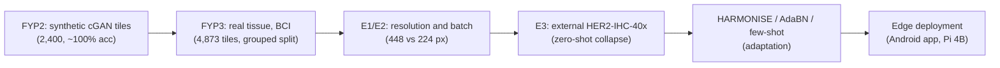
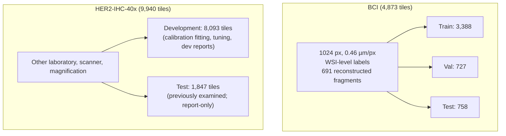
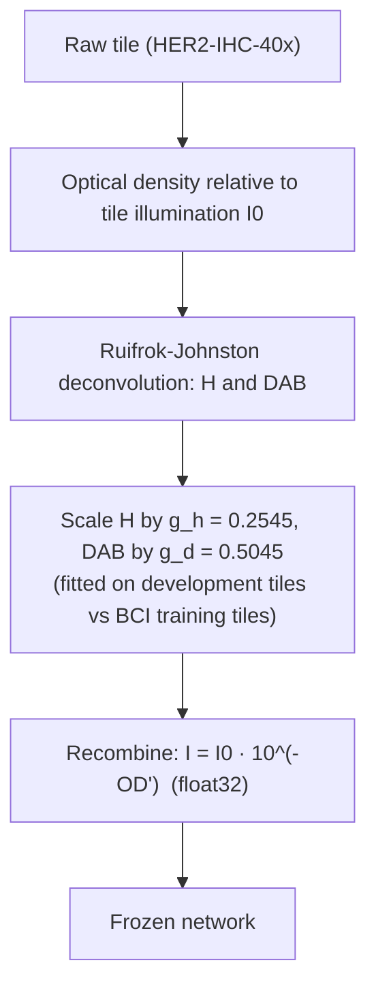

# Cross-Dataset Generalisation, Stain Calibration, and Edge Deployment for Automated HER2 Scoring in Breast Cancer Histopathology

**Final Technical Report — Final Year Project (FYP3)**
*Department of Electronics and Communication Engineering*
**Date**: 31 October 2026, **revised 10 November 2026**
**Project Root**: `/Users/dhaneswarareddy/Downloads/FYP3`
**Reference Project**: `/Users/dhaneswarareddy/Downloads/FYP2` (read-only archive)

> **Revision note (10 Nov 2026).** This version corrects factual errors found by an audit of every reported number
> against the stored artifacts, and adds the extended evaluation in `experiments_v2/`. The changes include:
> - Table 1/2 values;
> - the stain mechanism;
> - edge figures that had no measurement behind them (Pi INT8, phone "throttle" flags, energy claims);
> - dataset provenance and citations.
>
> Every change is listed with its evidence in `experiments_v2/REPORT_CORRECTIONS_v2.md`. The 31 Oct version is in the
> git history.

---

> [!CAUTION]
> ### Mandatory scientific disclosures
> 1. **No clinical validation.** All models and pipelines are research software. None was evaluated prospectively, in
>    a reader study, or by a regulator.
> 2. **No slide or patient identifiers.** Neither dataset releases slide or patient IDs.
>    - BCI "slide fragments" were reconstructed by matching continuous tile edges (`src/analysis_slides.py`).
>    - HER2-IHC-40x "index blocks" are runs of nearby file numbers, not slides.
>    - Patient- or slide-level generalisation cannot be claimed, and confidence intervals on HER2-IHC-40x are optimistic.
> 3. **The external test split is not untouched.** The labels of the 1,847-tile HER2-IHC-40x test split were inspected
>    during diagnostic audits, and the split was then evaluated by HARMONISE-1 and again in `experiments_v2`. All choices
>    were fixed on development data, but every external result is an exploratory evaluation of a previously examined
>    split, not a blind test.
> 4. **Equivocal categories remain weak.** On the external test split, the 224 px EfficientNetV2B0 with HARMONISE has
>    1+ recall 0.177 and 2+ precision 0.093. MobileNetV3Small has 2+ recall 0.090. DenseNet121 has 1+ and 2+ recall
>    0.000. High QWK (> 0.80) is driven by separating 0 from 3+.
> 5. **HARMONISE is an empirical calibration, not a physical stain normalisation.** It applies two gains fitted to
>    match optical-density quantiles of the target development tiles to BCI training tiles. It needs that reference
>    domain.
> 6. **Edge measurements** (§14, re-measured 10 Nov 2026 with one protocol on all devices):
>    - What was measured: network latency on Samsung Galaxy M35 5G, Realme 6 and Raspberry Pi 4B; on-device accuracy of
>      the Android app; Mac-side accuracy of every exported precision.
>    - Power: phones measured later the same day from the battery fuel gauge (§14.6); Raspberry Pi not measured.
>    - Android does not expose CPU throttling to a normal user; phone temperatures are **battery** temperatures.
>    - The INT8 model failed the project's accuracy gate and is reported for speed only.

---

## 1. Abstract

Automated scoring of human epidermal growth factor receptor 2 (HER2) from immunohistochemistry (IHC) guides therapy
for breast cancer. FYP2 reached near-perfect accuracy on synthetic conditional-GAN images. FYP3 tests the transition to
real tissue with two datasets:
- 4,873 tiles from the Breast Cancer Immunohistochemical (BCI) dataset;
- 9,940 tiles from the external HER2-IHC-40x dataset (University of Malaya).

**In-domain results.**
- Baseline networks reach 85.4%–90.8% validation accuracy on a leakage-controlled grouped BCI split.
- Raising the input resolution from 224 to 448 px improves EfficientNetV2B0 against a batch-matched control:
  ΔVal QWK = +0.105, 95% CI [0.056, 0.168]; ΔTest QWK = +0.063 [0.026, 0.116].
- This gives the primary model `EfficientNetV2B0__ce__hires`: val acc 0.950, QWK 0.935; test acc 0.975, QWK 0.959.
- The resolution effect was **not** confirmed for MobileNetV3Small.
- Synthetic pretraining and mixed synthetic-real training gave no measurable benefit.
- Freezing the backbone costs about 19 accuracy points.

**External results.** Zero-shot on HER2-IHC-40x, the BCI networks collapse: accuracy 0.42–0.59, balanced accuracy
0.26–0.38, with widespread over-calling of 3+.
- HARMONISE, an unsupervised optical-density gain calibration, raises 224 px EfficientNetV2B0 balanced accuracy from
  0.301 to 0.503.
- But it converts false 3+ calls into false 2+ calls (61% of negatives called 2+) and breaks the 448 px model
  (balanced accuracy 0.186).
- Adaptive batch normalisation (AdaBN) is network-dependent (0.36–0.52) but rescues the 448 px model (0.516).
- A few labelled target tiles help far more: with 5 labelled tiles per class, full fine-tuning reaches
  0.782 ± 0.053 test balanced accuracy.
- Networks trained on FYP2's synthetic images score better on this external set than any BCI network, a result
  explained by its colour separability (§12.4).

**Deployment.** The primary model runs in an Android app whose preprocessing is bit-exact with training. On the
full BCI test split it reproduces the validated predictions on **758/758 tiles** on both a Samsung Galaxy M35 5G and a
Realme 6 (accuracy 0.975).
- Median network latency per 448 px tile is 81 ms (Samsung, 4 threads), 139 ms (Realme, 8 threads) and 337 ms
  (Raspberry Pi 4B, 4 threads), with no throttling observed.
- The INT8 model is 3–4× faster but fails the accuracy gate (agreement 0.928), so it is not deployed.
- Phone power (battery fuel gauge, whole device, screen on): inference adds about 4 W at 4 threads, i.e. 0.39 J
  (Samsung) and 0.61 J (Realme) per tile above idle. Raspberry Pi power was not measured.

---

## 2. Introduction and Motivation

Breast cancer is the most frequently diagnosed cancer in women. HER2 is over-expressed or amplified in about 15–20% of
invasive breast carcinomas, and HER2 status decides eligibility for anti-HER2 therapy. HER2 is scored on IHC slides
following the ASCO/CAP guideline (2018 focused update; HER2-low addendum 2023):
- **IHC 0**: no staining, or incomplete, faint or barely perceptible membrane staining in ≤ 10% of invasive tumour cells.
- **IHC 1+**: incomplete, faint or barely perceptible membrane staining in > 10% of tumour cells.
  - HER2-negative, but **HER2-low**, which is relevant for trastuzumab deruxtecan.
- **IHC 2+ (equivocal)**: weak to moderate complete membrane staining in > 10% of tumour cells.
  - Reflex in situ hybridisation (ISH) is required.
- **IHC 3+ (positive)**: complete, intense circumferential membrane staining in > 10% of tumour cells.

Manual scoring is subjective, especially between 1+ and 2+. FYP2 trained ResNet50, EfficientNet, MobileNet and DenseNet
networks on synthetic cGAN IHC tiles and reached > 99.5% accuracy on that synthetic distribution. Whether this transfers
to real, heterogeneously stained tissue was untested. FYP3 addresses this, adds a second real dataset from another
laboratory, investigates calibration and adaptation, and evaluates deployment on low-cost hardware.

---

## 3. Problem Statement and Objectives

### 3.1 Core challenges
1. **Synthetic-to-real gap.** GAN tiles lack real artefacts, stroma, out-of-focus regions and batch staining variation.
2. **Inter-laboratory drift.** Tissue processing, antibody clone, staining protocol and scanner change colour, sharpness
   and magnification.
3. **The 1+/2+ boundary.** It is a continuum of membrane completeness and intensity. Labels are inherited from the parent
   image or region, so tile-level label noise is expected.
4. **Compute constraints.** Point-of-care use needs inference on low-cost devices without uploading whole slides.

### 3.2 Objectives
- **O1.** Evaluate the FYP2 architecture spectrum on real tissue (BCI), with a grouped split that prevents leakage.
- **O2.** Measure the paired effect of input resolution (448 vs 224 px) and batch size (8 vs 32), with bootstrap CIs.
- **O3.** Test whether FYP2's synthetic images help, through weight transfer (`init_fyp2`) or mixed training
  (`mix_fyp2`).
- **O4.** Evaluate zero-shot transfer to HER2-IHC-40x, and develop unsupervised calibration (HARMONISE). HARMONISE uses
  no target labels; its reference is the BCI training tiles.
- **O5.** Deploy to physical devices (Android phones, Raspberry Pi 4B) and measure latency, memory, thermal behaviour
  and on-device agreement.
- **O6 (added in `experiments_v2`).** Clinical error costs, uncertainty, explanation, robustness, AdaBN, few-shot
  adaptation and ablations (§15).

---

## 4. Related Work and Research Gap

1. **Classical membrane analysis.** Colour deconvolution (Ruifrok & Johnston, 2001) with segmentation and
   membrane-completeness rules. Interpretable, but brittle to staining and artefacts.
2. **CNNs.** Transfer learning (He et al., 2016; Tan & Le, 2021) works on closed benchmarks. The BCI dataset
   (Liu et al., 2022) made tile-level IHC data widely available. Cross-laboratory evaluation is rare.
3. **Stain normalisation and adaptation.** Reinhard, Macenko (2009) and Vahadane (2016) map images to a reference
   colour space, and generative methods (CycleGAN) can hallucinate structure. Batch-statistics adaptation (AdaBN;
   Li et al., 2016) needs no labels.

**Gap addressed.** FYP3 adds four things:
- cross-laboratory evaluation without retraining, with paired statistics;
- class-wise and clinically weighted error analysis on 1+/2+;
- a comparison of unsupervised calibration, AdaBN and few-shot adaptation;
- measured deployment on phones and a single-board computer.

---

## 5. Dataset Provenance, Labels, and Limitations

| Attribute | FYP2 synthetic | BCI (internal) | HER2-IHC-40x (external) |
|---|---|---|---|
| **Source** | cGAN tiles generated in FYP2 | Liu et al., CVPR Workshops 2022 (arXiv:2204.11425); non-commercial licence | University of Malaya release: Data in Brief 2025 (doi 10.1016/j.dib.2025.111922), Zenodo 10.5281/zenodo.15179607; CC BY-SA 4.0. 107 WSIs at 40×, 3DHistech Pannoramic DESK |
| **Tiles** | 2,400 (600 per class) | 4,873 IHC tiles, 1024×1024 | 9,940 tiles, 1024×1024 |
| **Resolution** | 256 px | 0.46 µm/px | µm/px not reported (40×); detected stain blobs are 2–6× larger than in BCI |
| **Labels** | Generator condition | Per image: "which category of WSI the image came from, not the image itself" (BCI README) | Class folder per tile (ROI-level, expert pathologists) |
| **Partitions used** | 70/15/15 | Grouped split: 3,388 / 727 / 758 | Development archive 8,093 tiles; WSI-based test split 1,847 tiles (0/1+/2+/3+ = 658/316/111/762). The release reports 86/21 WSIs but gives **no slide IDs** |
| **Grouping unit** | cGAN seed twins | Reconstructed slide fragments (edge matching) | None available (filename runs only) |

### Label integrity disclosures
1. **BCI labels are inherited from the parent WSI.** A third-party refined patch label exists for 3,513 of 4,873 tiles
   (Zenodo 10.5281/zenodo.17200604; labelling method undocumented). It agrees with the filename label on 82% of tiles,
   but only on **69.7%** of grouped-validation 2+ tiles and **73.6%** of grouped-test 2+ tiles. In-domain scores
   therefore measure agreement with WSI-level labels, not cell-level truth.
2. **Scan type is associated with label in BCI.** Grey vs bright scans make up 25/44/52/68% of tiles in classes
   0/1+/2+/3+, which is a potential shortcut (`DATASET.md`).
3. **HER2-IHC-40x was colour-filtered per class.** The release selected tiles by hue histogram. This makes the external
   set unusually separable by colour (§12.4).

---

## 6. Data Splits and Leakage Prevention

### 6.1 BCI grouped split
- BCI has no slide IDs, and the official split leaks: tiles cut side by side from one slide share a continuous border.
- `src/analysis_slides.py` links tiles whose edges continue into each other: mutual, unambiguous, as smooth as adjacent
  pixel columns. This gave 2,763 accepted links and 691 fragments.
- Whole fragments were assigned to train/val/test: 3,388 / 727 / 758 tiles, with no fragment in two splits.
- Bootstrap CIs resample fragments.

### 6.2 HER2-IHC-40x protocol
- Development archive (8,093 tiles) vs WSI-based test split (1,847 tiles), as released.
- Calibration gains, temperatures, thresholds and adaptation hyperparameters were fitted only on development tiles or
  on BCI training tiles.
- The test split was never used for fitting or selection, but it **was** examined during diagnostics (Disclosure 3).
- Without slide IDs, the test CIs resample runs of nearby file numbers and are optimistic.

---

## 7. Model Architectures and Training Methodology

### 7.1 Architectures
Nine backbones from five families (ImageNet weights):
- EfficientNetB0 (4.0 M) and EfficientNetV2B0 (5.9 M);
- MobileNetV2 (2.3 M), MobileNetV3Small (0.9 M) and MobileNetV3Large (3.0 M);
- DenseNet121 (7.0 M);
- ResNet50 (23.6 M);
- ConvNeXtTiny (27.8 M);
- NASNetMobile (4.3 M).

### 7.2 Two-stage schedule (FYP2 recipe)
- TensorFlow 2.15 / Keras; seed 42; one training run per configuration.
- **Stage 1:** head only, 5 epochs, Adam 1e-3, backbone frozen.
- **Stage 2:** all layers trainable, BatchNormalization kept in inference mode, ≤ 40 epochs, 2 warm-up epochs then
  cosine decay from 1e-4.
- **Early stopping:** validation QWK, patience 10, best weights restored. The maximum is 45 epochs in total.
  - Three runs ended at that cap: ResNet50, MobileNetV3Large CORN and EfficientNetV2B0 hires.
- **Augmentation:** flips, 90° rotations, mild brightness/contrast jitter (±10%).

### 7.3 Losses
- Cross-entropy (CE), 4-way softmax.
- CORN ordinal loss (3 conditional binary heads).

---

## 8. Evaluation Metrics

1. **Quadratic weighted kappa (QWK)**, with weights w_ij = (i − j)² / (K − 1)², K = 4. It penalises large ordinal
   errors.
2. **Balanced accuracy**: the mean of per-class recalls.
3. **Macro-F1.**
4. **Per-class precision and recall.** These are mandatory because aggregate metrics hide 1+/2+ failure (§13.3).
5. **Paired differences** Δ = metric_A − metric_B on the same tiles, with 95% bootstrap CIs:
   - BCI: resample fragments;
   - HER2-IHC-40x: resample filename runs.
   - "Confirmed" means the CI excludes 0. No p-values were computed.
6. **Clinical error taxonomy and workflow cost** (§15.1).

---

## 9. Baseline and Model Comparison Results (Phase A)

### Table 1: BCI grouped split, 224 px (values from `results/runs/*/summary.json`)

| Model | Loss | Batch | Best ep / run | Val Acc | Val BalAcc | Val F1 | Val QWK | Test Acc | Test BalAcc | Test F1 | Test QWK |
|---|:---:|:---:|:---:|:---:|:---:|:---:|:---:|:---:|:---:|:---:|:---:|
| **EfficientNetV2B0** | CE | 32 | 31 / 41 | 0.895 | 0.875 | 0.893 | **0.869** | 0.926 | 0.917 | 0.922 | 0.915 |
| DenseNet121 | CE | 16 | 32 / 42 | 0.908 | 0.894 | 0.901 | 0.854 | 0.942 | 0.922 | 0.927 | 0.910 |
| EfficientNetB0 | CE | 32 | 31 / 41 | 0.891 | 0.886 | 0.895 | 0.846 | 0.933 | 0.914 | 0.928 | 0.902 |
| ConvNeXtTiny | CE | 16 | 13 / 23 | 0.902 | 0.872 | 0.892 | 0.844 | 0.926 | 0.891 | 0.912 | 0.898 |
| DenseNet121 | CORN | 16 | 30 / 40 | 0.880 | 0.866 | 0.884 | 0.841 | 0.914 | 0.893 | 0.901 | 0.874 |
| EfficientNetV2B0 | CORN | 32 | 16 / 26 | 0.862 | 0.847 | 0.860 | 0.831 | 0.906 | 0.900 | 0.894 | 0.892 |
| ResNet50 | CE | 16 | 43 / 45 (cap) | 0.902 | 0.881 | 0.892 | 0.829 | 0.949 | 0.934 | 0.936 | 0.932 |
| MobileNetV3Large | CORN | 32 | 45 / 45 (cap) | 0.894 | 0.875 | 0.886 | 0.825 | 0.937 | 0.919 | 0.922 | 0.923 |
| NASNetMobile | CE | 32 | 28 / 38 | 0.884 | 0.851 | 0.865 | 0.805 | 0.921 | 0.895 | 0.912 | 0.904 |
| MobileNetV3Large | CE | 32 | 22 / 32 | 0.871 | 0.865 | 0.860 | 0.800 | 0.908 | 0.884 | 0.879 | 0.878 |
| MobileNetV2 | CE | 32 | 33 / 43 | 0.857 | 0.835 | 0.850 | 0.785 | 0.930 | 0.925 | 0.928 | 0.924 |
| MobileNetV3Small | CE | 32 | 34 / 44 | 0.854 | 0.822 | 0.833 | 0.763 | 0.913 | 0.886 | 0.895 | 0.888 |

### Key findings
1. **Real tissue is harder than synthetic.** FYP2 exceeded 99.5% on GAN tiles. On real BCI tissue, validation
   accuracy is 85.4%–90.8%.
2. **EfficientNetV2B0 (CE) has the highest validation QWK (0.869)** with 5.9 M parameters, so it was selected for the
   resolution study. Test results are higher than validation for every network: the test split is report-only and
   happens to be easier.
3. **CORN gives no consistent gain.**
   - Lower val QWK than CE for DenseNet121 (0.841 vs 0.854) and EfficientNetV2B0 (0.831 vs 0.869).
   - Higher for MobileNetV3Large (0.825 vs 0.800).

---

## 10. Resolution and Batch-Size Experiments (E1 and E2)

Downsampling a 1024 px tile to 224 px reduces linear resolution 4.6×. E1 (EfficientNetV2B0) and E2 (MobileNetV3Small)
test 448 px input with batch 8 (`hires`), against a batch-matched 224 px control (`lowbatch`, batch 8) and the standard
224 px run (batch 32).

### Table 2: E1 and E2 (values from `results/runs/*/summary.json`)

| Run | Input | Batch | Train time | Val Acc | Val BalAcc | Val F1 | Val QWK | Test Acc | Test BalAcc | Test F1 | Test QWK |
|---|:---:|:---:|:---:|:---:|:---:|:---:|:---:|:---:|:---:|:---:|:---:|
| **EffNetV2B0 `hires` (E1)** | **448** | 8 | 252 min | **0.950** | **0.945** | **0.950** | **0.935** | **0.975** | **0.973** | **0.971** | **0.959** |
| EffNetV2B0 `lowbatch` (E1) | 224 | 8 | 42 min | 0.868 | 0.868 | 0.865 | 0.829 | 0.905 | 0.901 | 0.898 | 0.896 |
| EffNetV2B0 standard | 224 | 32 | 49 min | 0.895 | 0.875 | 0.893 | 0.869 | 0.926 | 0.917 | 0.922 | 0.915 |
| MobileNetV3S `hires` (E2) | 448 | 8 | 45 min | 0.898 | 0.897 | 0.893 | 0.865 | 0.908 | 0.898 | 0.893 | 0.874 |
| MobileNetV3S `lowbatch` (E2) | 224 | 8 | 28 min | 0.857 | 0.831 | 0.844 | 0.775 | 0.905 | 0.875 | 0.881 | 0.857 |
| MobileNetV3S standard | 224 | 32 | 23 min | 0.854 | 0.822 | 0.833 | 0.763 | 0.913 | 0.886 | 0.895 | 0.888 |

### Table 3: Paired effects, 95% fragment-bootstrap CIs (`final_reports/tables/paired_effects.csv`)

| Experiment | Effect | Split | ΔAccuracy [95% CI] | ΔQWK [95% CI] | ΔMacro-F1 [95% CI] | CI excludes 0? |
|---|---|:---:|:---:|:---:|:---:|:---:|
| **E1 (EffNetV2B0)** | **Resolution** (448 vs 224, both b8) | Val | **+0.083** [0.051, 0.113] | **+0.105** [0.056, 0.168] | **+0.085** [0.052, 0.130] | **Yes** |
| **E1 (EffNetV2B0)** | **Resolution** (448 vs 224, both b8) | Test | **+0.070** [0.042, 0.106] | **+0.063** [0.026, 0.116] | **+0.073** [0.043, 0.110] | **Yes** |
| E1 (EffNetV2B0) | Batch (b8 vs b32, 224 px) | Val | −0.028 [−0.060, 0.007] | −0.040 [−0.109, 0.027] | −0.028 [−0.072, 0.010] | No |
| E1 (EffNetV2B0) | Combined (448 b8 vs 224 b32) | Val | **+0.055** [0.033, 0.076] | **+0.065** [0.026, 0.108] | **+0.057** [0.030, 0.087] | Yes |
| E2 (MobileNetV3S) | Resolution (448 vs 224, both b8) | Val | +0.041 [0.000, 0.086] | +0.090 [−0.007, 0.207] | +0.050 [0.001, 0.099] | QWK: no |
| E2 (MobileNetV3S) | Resolution (448 vs 224, both b8) | Test | +0.003 [−0.022, 0.031] | +0.017 [−0.034, 0.075] | +0.013 [−0.020, 0.048] | No |
| E2 (MobileNetV3S) | Batch (b8 vs b32, 224 px) | Val | +0.003 [−0.019, 0.026] | +0.012 [−0.061, 0.089] | +0.011 [−0.027, 0.050] | No |
| E2 (MobileNetV3S) | Batch (b8 vs b32, 224 px) | Test | −0.008 [−0.028, 0.010] | −0.030 [−0.067, −0.003] | −0.014 [−0.035, 0.004] | QWK: yes |
| E2 (MobileNetV3S) | Combined (448 b8 vs 224 b32) | Test | −0.005 [−0.031, 0.024] | −0.014 [−0.063, 0.038] | −0.002 [−0.034, 0.033] | No |

### Interpretation
1. **Resolution helps EfficientNetV2B0, and batch size does not explain it.**
   - Against the batch-matched 224 px control, 448 px gains +0.105 val QWK and +0.063 test QWK, with both CIs above 0.
   - The 448 px model is the primary model: test acc 0.975, QWK 0.959.
2. **The batch effect at 224 px is indistinguishable from 0 for EfficientNetV2B0** (val ΔQWK −0.040 [−0.109, 0.027]).
3. **The resolution effect is not confirmed for MobileNetV3Small.**
   - Val QWK +0.090 has a CI spanning 0, and the test gain is about 0.
   - Against the standard 224 px run, val improves (+0.102) but test does not (−0.014).
   - So resolution is a confirmed improvement for one of two architectures, not a general rule. One seed per arm.
4. **Costs of resolution** (§15):
   - 5.2× training time;
   - higher device latency (§14);
   - strong sensitivity to defocus (§15.4).

---

## 11. Synthetic Initialization and Mixed-Training Experiments (E4 and E5)

- **E4 (`init_fyp2`).** EfficientNetV2B0 initialised from the FYP2 synthetic model, then the same two-stage training on
  BCI.
- **E5 (`mix_fyp2`).** ImageNet initialisation; FYP2's 1,680 synthetic training tiles added to the 3,388 BCI training tiles and shuffled together (≈33% synthetic on average, not a fixed ratio per batch).

### Table 4: Synthetic pretraining and mixing (BCI)

| Run | Init | Data | Val Acc | Val BalAcc | Val F1 | Val QWK | Test Acc | Test BalAcc | Test QWK |
|---|---|---|:---:|:---:|:---:|:---:|:---:|:---:|:---:|
| **Standard baseline** | ImageNet | 100% BCI | 0.895 | 0.875 | 0.893 | 0.869 | 0.926 | 0.917 | 0.915 |
| E4 (`init_fyp2`) | FYP2 synthetic | 100% BCI | 0.902 | 0.881 | 0.887 | 0.854 | 0.920 | 0.919 | 0.894 |
| E5 (`mix_fyp2`) | ImageNet | BCI + 1,680 FYP2 (≈33%) | 0.884 | 0.877 | 0.879 | 0.847 | 0.917 | 0.915 | 0.910 |

### Table 5: Paired effects vs baseline

| Experiment | Split | ΔAccuracy [95% CI] | ΔQWK [95% CI] | ΔMacro-F1 [95% CI] | Excludes 0? |
|---|:---:|:---:|:---:|:---:|:---:|
| E4 (`init_fyp2`) | Val | +0.007 [−0.018, 0.029] | −0.015 [−0.075, 0.042] | −0.006 [−0.043, 0.029] | No |
| E4 (`init_fyp2`) | Test | −0.007 [−0.031, 0.022] | −0.021 [−0.068, 0.017] | −0.014 [−0.050, 0.021] | No |
| E5 (`mix_fyp2`) | Val | −0.011 [−0.036, 0.014] | −0.023 [−0.073, 0.020] | −0.014 [−0.047, 0.017] | No |
| E5 (`mix_fyp2`) | Test | −0.009 [−0.038, 0.023] | −0.005 [−0.035, 0.023] | −0.010 [−0.040, 0.022] | No |

**Verdict.** Neither synthetic pretraining nor synthetic mixing produced a measurable change on BCI. All CIs span 0,
with negative point estimates for QWK. On real BCI tissue, FYP2's synthetic images did not help. They did help on
HER2-IHC-40x (§12.4).

---

## 12. External Evaluation and HARMONISE-1

### 12.1 Zero-shot collapse (E3)
On the 1,847-tile HER2-IHC-40x test split, the ten BCI-trained networks reach accuracy 0.419–0.586 and balanced
accuracy 0.260–0.381. They over-call 3+: 43%–94% of all tiles are predicted 3+, including most true-0 tiles.

| Network | Acc | BalAcc | Macro-F1 | QWK | Tiles predicted 3+ |
|---|:---:|:---:|:---:|:---:|:---:|
| EfficientNetV2B0 224 | 0.448 | 0.301 | 0.235 | 0.108 | 87.9% |
| EfficientNetV2B0 448 (`hires`) | 0.435 | 0.290 | 0.318 | 0.432 | 42.7% |
| DenseNet121 224 | 0.419 | 0.260 | 0.176 | 0.032 | 93.1% |

### 12.2 Stain and image differences
Stain was measured relative to each tile's own illumination (Ruifrok–Johnston vectors). Values are the per-class
**median over tiles** of each tile's mean optical density (`final_reports/tables/cross_dataset_features_by_class.csv`):

| Feature | Dataset | 0 | 1+ | 2+ | 3+ |
|---|---|:---:|:---:|:---:|:---:|
| DAB | BCI | 0.09 | 0.09 | 0.12 | 0.49 |
| DAB | HER2-IHC-40x | 0.05 | 0.16 | 0.31 | 1.29 |
| Haematoxylin | BCI | 0.08 | 0.02 | 0.03 | 0.03 |
| Haematoxylin | HER2-IHC-40x | 0.29 | 0.11 | 0.17 | 0.09 |

- **Haematoxylin is 3.4–7× stronger in HER2-IHC-40x**, not depressed.
- DAB is higher for 1+, 2+ and 3+ (2–3×), and lower for class 0.
- External tiles are also blurrier (sharpness 68–766 vs 554–2,279) and have larger detected stain blobs (diameter 5–14 px vs
  2–3 px), consistent with a different magnification.
- A network that learned "more brown = higher score" on BCI therefore over-calls on the external set.

### 12.3 HARMONISE formulation and results
HARMONISE scales the deconvolved optical densities: OD_H' = g_h·OD_H and OD_D' = g_d·OD_D. Both are measured
relative to each tile's illumination I0, recombined as I = I0·10^(−OD'). The gains come from matching the
99th-percentile optical density of the target **development** tiles (fit pool, 1,500 tiles) to **BCI training** tiles
(`stain_p99`): g_h = 0.2545, g_d = 0.5045. Network weights are unchanged. The calibrated image must be passed to the
network as float32: an 8-bit round trip changes 1.4% of predictions (`experiments_v2/03_gradcam`).

### Table 6: External test split (1,847 tiles), before and after HARMONISE-1

| Architecture | Input | Arm | Acc | BalAcc | Macro-F1 | QWK | Rec 0 | Rec 1+ | Rec 2+ | Rec 3+ |
|---|:---:|:---:|:---:|:---:|:---:|:---:|:---:|:---:|:---:|:---:|
| EffNetV2B0 | 224 | Raw | 0.448 | 0.301 | 0.235 | 0.108 | 0.011 | 0.184 | 0.009 | 1.000 |
| **EffNetV2B0** | **224** | **HARMONISE-1** | **0.571** | **0.503** | **0.448** | **0.593** | 0.301 | 0.177 | 0.568 | 0.967 |
| MobileNetV3S | 224 | Raw | 0.508 | 0.337 | 0.301 | 0.210 | 0.195 | 0.152 | 0.000 | 1.000 |
| MobileNetV3S | 224 | HARMONISE-1 | 0.755 | 0.528 | 0.516 | 0.802 | 0.888 | 0.139 | 0.090 | 0.993 |
| DenseNet121 | 224 | Raw | 0.419 | 0.260 | 0.176 | 0.032 | 0.009 | 0.041 | 0.000 | 0.991 |
| DenseNet121 | 224 | HARMONISE-1 | 0.624 | 0.410 | 0.382 | 0.765 | 0.944 | 0.000 | 0.000 | 0.698 |
| EffNetV2B0 `hires` | 448 | Raw | 0.435 | 0.290 | 0.318 | 0.432 | 0.239 | 0.111 | 0.009 | 0.802 |
| EffNetV2B0 `hires` | 448 | HARMONISE-1 | 0.104 | 0.186 | 0.108 | −0.155 | 0.047 | 0.149 | 0.468 | 0.081 |

### Findings
1. **Partial recovery on 224 px networks.**
   - EfficientNetV2B0: balanced accuracy 0.301 → 0.503 (+0.202), QWK 0.108 → 0.593, 2+ recall 0.009 → 0.568.
   - But 2+ precision is only 0.093.
   - Clinically, false 3+ calls (758 → 64) become false 2+ calls (80 → 595 of 974 negatives), and missed 2+ rise from
     6 to 36 (§15.1).
2. **The 448 px model breaks.** Balanced accuracy 0.186, QWK −0.155, 3+ recall 0.802 → 0.081. The development-tile
   dose-response (§13.4) attributes this to the **haematoxylin** gain.

### 12.4 FYP2 synthetic-trained networks on the external set
`final_reports/cross_dataset_audit.md` gives the comparison:
- The FYP2 networks, trained only on GAN tiles and without calibration, reach balanced accuracy **0.61–0.73**.
- The 224 px BCI networks reach 0.41–0.53 with HARMONISE (the 448 px model drops to 0.186).
- In clinical-cost terms, the FYP2 ResNet50 has the lowest expected cost of all configurations (§15.1).

Probable explanation: HER2-IHC-40x was hue-filtered per class, and FYP2's GAN classes differ strongly in DAB colour
(median DAB 0.09/0.09/0.46/0.94). A 6-feature stain rule fitted on FYP2 reaches accuracy 0.89 on the external set. This
reflects the external set's colour separability, not better tissue understanding by the synthetic models.

---

## 13. HARMONISE-2 Reliability Analysis

Five experiments (A–E) on the 4,593 unused development tiles (R; split into R_cal 2,191 and R_eval 2,402).

### 13.1 A: Parameter stability
Over 1,000 bootstrap resamples:
- At n = 100 tiles, the coefficient of variation is CV(g_d) = 0.142.
- At n = 1,000, CV(g_h) = 0.033 and CV(g_d) = 0.055.
- **At least about 1,000 unlabelled tiles are needed for CV ≈ 0.05.**

### 13.2 B: Slide-grouping audit
Neither dataset contains slide metadata. Filename runs are acquisition sequences; slide- or patient-level grouping is
impossible.

### 13.3 C: Class-wise failure and the QWK paradox
MobileNetV3Small with HARMONISE-1 reaches test QWK 0.802, while its 1+ recall is 0.139 and 2+ recall 0.090. QWK
penalises large ordinal errors quadratically: separating 0 from 3+ dominates the score even when 86% of 1+ and 91% of
2+ tiles are misclassified. In clinical terms, 47% of true 1+ tiles are called 3+ (§15.1).

### 13.4 D: Why the 448 px model breaks
Dose-response on 1,200 development R_eval tiles (`next_experiment/harmonise2/outputs/D_external_EfficientNetV2B0__ce__hires.csv`),
3+ recall:

| Arm | 3+ recall |
|---|---|
| No calibration | 0.849 |
| DAB gain only (g_d 0.50) | 0.852 |
| **Haematoxylin gain only (g_h 0.25)** | **0.266** |
| Both gains | 0.307 |

- The collapse follows the **haematoxylin** gain. DAB dimming alone leaves 3+ recall unchanged.
- Why haematoxylin matters more at 448 px (for example nuclear context) was not tested.
- Scale compensation (`frozen_scale2`) on the same development tiles: balanced accuracy 0.279 (none) → 0.228
  (frozen) → 0.322 (frozen_scale2).
  - That is +0.043 over no calibration, but it **failed** the pre-set acceptance rule because 3+ recall fell by more
    than 0.10.
  - The 0.186 test result and the 0.322 development result come from different data sets and must not be compared.
- AdaBN, by contrast, rescues the 448 px model (§15.5).

### 13.5 E: Confidence-based referral on development tiles
Thresholds were fitted on R_cal and reported on R_eval at target coverages 0.5 / 0.7 / 0.9.
- For EfficientNetV2B0 + HARMONISE, the 0.5 target (realised 0.44–0.46) refers 74%–79% of true 2+ tiles.
- Across networks at 0.5, the figure is 76%–94%.
- Out of domain, referral concentrates on 2+, so it cannot replace review of equivocal cases.
- In-domain referral works well (§15.2).

---

## 14. Edge Deployment: Android Application, Smartphones and Raspberry Pi 4B

All numbers in this section were measured on 10 November 2026 with one protocol (`experiments_v2/08_edge`). The
earlier 31 October measurements, and the claims built on them, are superseded (see "What changed" below).

### 14.1 Hardware

| Device | SoC (CPU) | OS | Runtime |
|---|---|---|---|
| Samsung Galaxy M35 5G (SM-M356B) | Exynos 1380 (4× A78 2.4 GHz + 4× A55 2.0 GHz) | Android 17 (API 37) | TFLite `benchmark_model` (XNNPACK) / app: TFLite 2.16.1 |
| Realme 6 (RMX2001) | MediaTek Helio G90T (2× A76 2.05 GHz + 6× A55 2.0 GHz) | Android 11 (API 30) | same |
| Raspberry Pi 4 Model B Rev 1.4, 4 GB | BCM2711 (4× A72 1.8 GHz) | Debian 13 aarch64 | `ai_edge_litert` 2.5.4 (Python) |

- **Protocol.**
  - Every configuration: 10 warm-up runs, then 100 timed invokes.
  - Phones: 60 s cool-down between configurations.
  - Raspberry Pi: a fresh process for each configuration.
  - Threads 1/2/4/8 on the phones and 1/2/4 on the Pi. No CPU affinity is set anywhere: the OS scheduler chooses the
    cores.
  - Latency is network time per tile. Decode and resize are not included, except where stated.
- **Raspberry Pi.**
  - Official-rating supply; `throttled` read before and after every configuration.
  - Governor `performance` during the run, restored to `ondemand` afterwards.
- **Phones.**
  - CPU thermal zones are not readable without root.
  - The temperatures shown are battery temperatures.
  - No throttle flag exists on Android.
- **Power.** Phones: measured separately from the battery fuel gauge (§14.6). Raspberry Pi: not measured.

### 14.2 Accuracy of the exported model (Mac, all 727 val + 758 test BCI tiles)

| Precision | File (MiB) | Val acc | Test acc | Test QWK | Test 1+ recall | Agreement with Keras (val / test) |
|---|---|---|---|---|---|---|
| FP32 | 22.4 | 0.950 | 0.975 | 0.959 | 0.960 | 1.000 / 1.000 |
| **FP16 (deployed)** | 11.3 | 0.950 | 0.975 | 0.959 | 0.960 | 1.000 / 1.000 |
| INT8 | 6.8 | 0.919 | 0.933 | 0.907 | **0.855** | **0.928** / 0.943 |

- FP16 is lossless.
- INT8 fails the project's 0.95 agreement gate and loses 10 points of 1+ recall. It is reported **for speed only and
  must not be used for scoring**.
- On the Pi, INT8 is worse still: it agrees with Keras on 109 of 120 reference tiles (0.908), and with the Mac INT8
  output on only 114 of 120. INT8 results are therefore platform-dependent.

### 14.3 Network latency (median ms; p95 in brackets)

| Device | Model | 1 thread | 2 threads | 4 threads | 8 threads | Peak memory (MB) |
|---|---|---|---|---|---|---|
| Samsung M35 | 448 px FP16 (deployed) | 214.9 | 119.0 | **81.4** [107.5] | 95.1 [729.4] | 120 |
| Samsung M35 | 448 px FP32 | 214.0 | 127.6 | 80.7 [154.1] | 85.0 | 90 |
| Samsung M35 | 448 px INT8 (rejected) | 75.4 | 38.7 | 21.7 | 45.3 | 40 |
| Samsung M35 | 224 px FP16 | 53.5 | 28.6 | 16.8 | 20.3 | 92 |
| Realme 6 | 448 px FP16 (deployed) | 301.7 | 174.9 | 142.6 | **139.1** [181.8] | 124 |
| Realme 6 | 448 px FP32 | 300.5 | 173.6 | 142.0 | 143.2 | 95 |
| Realme 6 | 448 px INT8 (rejected) | 98.8 | 53.6 | 48.4 | 34.3 | 42 |
| Realme 6 | 224 px FP16 | 73.4 | 40.1 | 32.2 | 26.3 | 94 |
| Raspberry Pi 4B | 448 px FP16 (deployed) | 761.8 | 437.0 | **336.5** [349.2] | — | 250 (Python process) |
| Raspberry Pi 4B | 448 px FP32 | 755.0 | 435.7 | 334.5 | — | 202 (Python process) |
| Raspberry Pi 4B | 448 px INT8 (rejected) | 361.3 | 187.9 | 104.1 | — | 151 (Python process) |

- **Phone thermals.** Battery temperature rose from 29.7 to 31.7 °C (Samsung) and from 29.6 to 32.0 °C (Realme)
  across all 16 configurations each.
- **Pi thermals.** SoC temperature stayed at or below 62.8 °C, and `throttled=0x0` before and after every
  configuration.

**Interpretation.**
- **Speed.** For the deployed 448 px FP16 model, the fastest configuration is:

  | Device | Fastest configuration | vs Pi |
  |---|---|---|
  | Samsung | 81 ms (4 threads) | 4.1× faster |
  | Realme | 139 ms (8 threads) | 2.4× faster |
  | Pi | 337 ms (4 threads) | — |

  On CPU, FP16 runs at FP32 speed: the weights are expanded to FP32. FP16 only halves the file size.
- **Threads.**
  - Scaling is sub-linear on every device, as expected.
  - On the Samsung, 8 threads is slower and much more variable than 4 (FP16 p95 729 ms).
  - Without core pinning, the scheduler decides which cores run the threads. The earlier micro-architectural
    explanations ("A55 synchronisation stall", "pinned to the A78 cores") were not tested and are withdrawn.
- **Resolution cost.** The 224 px model is 4.8× (Samsung, 4 threads) to 5.3× (Realme, 8 threads) faster than the
  448 px model.
- **INT8.** INT8 is 3–4× faster, but it is not a deployable option (§14.2).

### 14.4 The Android application (`HER2 Edge Classifier`, v1.1)

**Correction.** Version 1.0 (31 Oct) resized tiles in one step (`createScaledBitmap`, 1024 → 448). The model was
trained and validated with 1024 → Lanczos 512 → bilinear 448.

**Version 1.1 changes:**
- **Exact preprocessing.** A Kotlin port of Pillow's fixed-point resampler (`PilResample.kt`). Its Python twin
  (`experiments_v2/08_edge/pil_resample_port.py`) is bit-identical to PIL.
- **INT8 labelled honestly.** "Speed test only", with an explicit warning on every INT8 result.
- **Accurate interface text:**
  - ASCO/CAP text updated, including HER2-low for 1+;
  - removed "big.LITTLE affinity" and "Neural Engine" (inference is CPU-only, with no pinning);
  - single-tile latency and total time shown instead of an extrapolated "FPS";
  - a disclaimer that states the external-domain failure.
- **Dark-mode fix.** Radio-button labels were invisible on the Realme in dark mode, a pre-existing bug; fixed.
- **Validation mode.** A research mode classifies pushed tiles through exactly the UI path.

**On-device accuracy** (first measurement of what the phones actually predict; `ondevice_validation.py`). The full BCI
grouped **test** split (758 original 1024 px tiles) plus the 120 validation reference tiles, run through the app on
each phone:

| | Test acc | Test bal. acc | Test QWK | Agreement with Keras (758 test tiles) | Max \|Δp\| | Reference tiles (120): acc / agreement |
|---|---|---|---|---|---|---|
| Mac TFLite FP16 (training path) | 0.975 | 0.973 | 0.959 | 1.000 | 0.018 | 0.950 / 1.000 |
| **Samsung M35, app v1.1** | **0.975** | 0.973 | 0.959 | **758/758** | 0.018 | 0.950 / 120/120 |
| **Realme 6, app v1.1** | **0.975** | 0.973 | 0.959 | **758/758** | 0.068 | 0.950 / 120/120 |

- The phones reproduce the validated model exactly at the level of predicted class.
- The v1.0 one-step resize was simulated on the Mac. It changes 0.1–2.8% of predictions, with no consistent accuracy
  loss (`android_preprocessing_check.csv`).
- In-app time per 1024 px tile (median), from single passes inside the app, not a controlled benchmark:

  | Phone | Resize | Network |
  |---|---|---|
  | Samsung | 211 ms | 132 ms |
  | Realme | 145 ms | 227 ms |

**Packaging note.** Android 15+ warns that the bundled TFLite 2.16.1 native library is not 16 KB page-aligned. Both
test phones use 4 KB pages, so it runs. Devices with 16 KB pages would need a newer runtime (LiteRT), which would have
to be re-validated.

### 14.5 What changed from the 31 October edge results

| Earlier claim | Status |
|---|---|
| Pi INT8 122.9 ms (8.14 FPS), "81.5 °C" | **Never measured.** Measured now: 104.1 ms (4 threads), 61.8 °C, no throttling |
| Phones "throttled = 0x0", "zero thermal throttling" | Android has no such flag; the values were battery temperatures. Now reported as battery temperatures |
| INT8 "46 FPS real-time", "whole-slide pan-and-scan with zero lag" | INT8 failed the accuracy gate; no slide viewer was built. Removed |
| "Per-watt efficiency", energy advantages | Nothing was measured. Removed |
| "Pinned to 4 × A78", "A55 barrier stall (+97.6%)" | No affinity was set; untested hypothesis. Removed |
| Samsung 224 px FP16, 1 thread: 176.8 ms (super-linear 5.7× from 1 to 2 threads) | Re-measured: 53.5 ms → 28.6 ms (1.9×). The old value was a scheduling artefact |
| Realme 448 px FP16: 409 / 229 / 190 / 145 ms | Re-measured: 302 / 175 / 143 / 139 ms. Conditions for the old run are unknown |
| Pi 448 px FP16, 4 threads: 353.5 ms at 84.2 °C, `0x80008` | Re-measured with an official-rating supply: 336.5 ms at 61.8 °C, `0x0`. The old run hit the soft temperature limit (flags `0x80000`/`0x80008`) |
| App "computes the same prediction as the validated model" | False for v1.0 (one-step resize). True for v1.1: 758/758 on both phones |
| Samsung "Android 16" | The phone now reports Android 17 (the OS was updated); the 31 Oct run was on 16 |

---

### 14.6 Smartphone power and energy per tile (`experiments_v2/10_power`, 10 Nov 2026; next-semester material)

Whole-phone battery power from each phone's own fuel gauge while the deployed 448 px FP16 model ran continuously for
300 s (USB unplugged, screen on at fixed brightness), against a screen-on idle baseline measured before and after.

| | Samsung Galaxy M35 5G | Realme 6 |
|---|---|---|
| Idle, screen on | 0.74 W | 0.75 W |
| 4 threads: power (± SE) / added by inference | 4.75 W (± 0.41) / 4.01 W | 4.64 W (± 0.05) / 3.89 W |
| 4 threads: energy per tile, total / added | 0.47 J / 0.39 J | 0.73 J / 0.61 J |
| 1 thread: energy per tile, total / added | 0.69 J / 0.49 J | 0.84 J / 0.62 J |
| Sustained vs short-benchmark median latency, 4 threads | 99.1 vs 81.4 ms (+22%) | 151.6 vs 142.6 ms (+6%) |

- Four threads cost no more energy per tile than one, and less in total, because the screen and idle cost are spread
  over more tiles.
- Under 5 minutes of continuous load on battery, the Samsung is about 20% slower than in the short plugged-in
  benchmark (1 thread: +20%; Realme: +6% and 0%). The cause was not established; CPU temperature and frequency are not
  readable without root.
- **Limits.** Whole-device power, not CPU power; fuel-gauge resolution, not a calibrated meter; one run per
  configuration. The Samsung gauge updates only about every 30 s (SE about 9%); the Realme's about every second.

---

## 15. Extended Evaluation (`experiments_v2`, 10 Nov 2026)

Every experiment below has its own folder with scripts, outputs and a README (`experiments_v2/README.md`):
- choices were fixed on validation or development data;
- BCI test and HER2-IHC-40x test numbers are report-only;
- the HER2-IHC-40x test numbers are exploratory (Disclosure 3).

### 15.1 Clinical error taxonomy and cost (`01_clinical_risk`)
- **Taxonomy.** Errors are grouped by ASCO/CAP consequence:
  - 3+ → negative (positive missed);
  - 2+ → negative (ISH missed);
  - 2+ → 3+ (ISH bypassed);
  - negative → 3+ (false positive);
  - negative → 2+ (unnecessary ISH);
  - 3+ → 2+ (delay);
  - 0 ↔ 1+.
- **Workflow cost (S2).** Illustrative and fixed in advance; tested under ±50% perturbation.
- **BCI test results.**
  - 448 px: 0.12 [0.06, 0.22] vs 224 px: 0.31 [0.20, 0.48].
  - Paired Δ −0.19 [−0.33, −0.09].
  - In the ±50% cost-weight sensitivity analysis (BCI **validation**, all 20 runs), the 448 px model has the lowest
    cost in 100% of draws.
- **External.** The FYP2 ResNet50 (raw) has the lowest cost (0.54) in 100% of draws.
- **What HARMONISE does to the 224 px EfficientNetV2B0's errors:**
  - negatives called 3+ fall from 758 to 64;
  - negatives called 2+ rise from 80 to 595 (61% of negatives);
  - missed 2+ rise from 6 to 36.

### 15.2 Calibration and selective prediction (`02_uncertainty`)
- **In-domain calibration is already good.** BCI test ECE is 0.010–0.078. Temperature scaling helps only some runs.
- **In-domain referral works.** The 448 px model at 93.7% coverage: accuracy 0.975 → 0.989, gain +0.014
  [+0.005, +0.026]. It catches 58% of errors while referring only 3.7% of 2+ tiles.
- **On the external test split, referral targets 2+.** 50.5% of 2+ tiles are referred at 70% coverage.
- **Development-fitted temperature transfers.** ECE falls from 0.205 to 0.099.

### 15.3 Grad-CAM (`03_gradcam`)
- **Scope.** 448 and 224 px models; BCI and external; correct and wrong tiles; 7,057 tiles with statistics. The maps are
  7×7 or 14×14, so they cannot resolve membranes.
- **3+ calls.** Correct 3+ calls attend to strongly brown regions: DAB ratio 1.23–1.29 and background ratio 0.66–0.75
  on BCI; 1.22–1.42 and 0.55–0.69 on the external sets.
- **External 1+ calls.** Correct external 1+ calls attend to glass and pale areas (background ratio 1.07–1.23), a
  likely shortcut.
- **BCI errors cluster on sparse tiles.** 55–63% of errors are > 50% background, vs 32% of correct tiles.

### 15.4 Robustness (`04_robustness`; BCI test, perturbations at native resolution)
- **Brightness ±15%** costs 12–19 points of balanced accuracy for both models.
- **Defocus (448 px model):**
  - blur σ = 0.9 µm costs 0.17, vs 0.03 at 224 px;
  - σ = 1.8 µm costs 0.42, with tiles pushed to 2+.
- **Negligible effect:** JPEG ≥ 70, sensor noise, ±20% DAB, and haematoxylin ×1.2.
- **Small but real:** haematoxylin ×0.8 costs about 3 points of balanced accuracy (−0.031 at 448 px, −0.030 at
  224 px; both CIs exclude 0).

### 15.5 AdaBN (`05_adabn`; 5 networks, unlabelled 1,500-tile fit pool)
- **Against raw input** it improves test balanced accuracy on every network: +0.06 to +0.23, all CIs > 0.
- **Against HARMONISE** it depends on the network:

  | Network | AdaBN − HARMONISE (test BalAcc) |
  |---|---|
  | MobileNetV3Small | −0.13 |
  | 224 px EfficientNetV2B0 | tie |
  | 448 px model | +0.33 (0.186 → 0.516; 3+ positives missed 298 → 74) |

- With HARMONISE inputs, AdaBN is better than HARMONISE alone for MobileNetV3Large and DenseNet121 (+0.08 to +0.09).
- The best unsupervised external balanced accuracy is about 0.52–0.53 on any network.

### 15.6 Few-shot adaptation (`06_fewshot`; 224 px EfficientNetV2B0, tuned on R_cal, 5 support draws)
External test balanced accuracy for full fine-tuning:
- k = 1 per class: 0.544 ± 0.024;
- **k = 5: 0.782 ± 0.053** (QWK 0.918);
- k = 10: 0.813 ± 0.043;
- k = 20: 0.845 ± 0.048 (QWK 0.950).

For comparison: zero-shot 0.301, HARMONISE 0.503, AdaBN 0.522. A handful of labelled target tiles beats every
unsupervised method. Partial fine-tuning was non-monotone, because its 3-draw tuning was optimistic.

### 15.7 Ablation (`07_ablation`; BCI, EfficientNetV2B0)
- **Frozen ImageNet backbone with a linear head:** −0.193 val accuracy, −0.267 val QWK.
- **An MLP head does not help** (±0.03, CIs span 0).
- **Unfreezing only `block6` + `top`** (76% of weights): −0.089 val QWK.
- **Resolution vs batch.** Re-analysis confirms the E1 resolution effect is not a batch artefact (Table 3).

---

## 16. Discussion

### 16.1 Synthetic training: no help on BCI, but a colour-separable external set
- FYP2's GAN-trained classifiers reach about 100% on GAN tiles, and synthetic pretraining or mixing did not improve
  BCI performance (E4/E5).
- On HER2-IHC-40x, however, the synthetic-trained FYP2 networks beat every BCI network.
- The likely reason is that both FYP2's GAN classes and the hue-filtered external set are separable by DAB colour.
- The correct conclusion is narrower than "synthetic generalisation is a myth": synthetic training did not transfer to
  BCI, and external benchmarks with per-class colour selection reward colour shortcuts.

### 16.2 Resolution matters for EfficientNetV2B0
- **In-domain gain.** 448 px input gave the largest in-domain gain observed: +0.105 val QWK against the batch-matched
  control, larger than the spread between architectures at 224 px (val QWK 0.763–0.869).
- **Not confirmed for MobileNetV3Small.**
- **Costs:** training time, device latency and defocus sensitivity.

### 16.3 Aggregate metrics hide clinical failure
- **Paradox.** MobileNetV3Small + HARMONISE has QWK 0.802 with 1+ recall 0.139 and 2+ recall 0.090.
- **Error profiles.** HARMONISE and AdaBN trade different clinical errors (§15.1, §15.5).
- **Reporting rule.** Per-class precision and recall, and error-type counts, should be mandatory.

### 16.4 What works across laboratories
- **Unsupervised fixes reach about half of the possible accuracy:** HARMONISE about 0.50, AdaBN about 0.52.
- **They fail in different ways.**
- **A small labelled calibration set works far better.** Five labelled tiles per class give about 0.78.
- **Practical route to a new site:** a small labelled set, fine-tuning, and pathologist review of 2+ tiles.

---

## 17. Limitations and Ethical Considerations

1. **Not a medical device.** The software must not guide treatment decisions.
2. **Two datasets, two laboratories, tile level only.** No slide IDs, no slide or patient aggregation, and no
   pathologist review of model outputs.
3. **Labels.** BCI labels are inherited from the WSI, and 2+ label agreement with refined patch labels is only 70–74%.
4. **One training seed per configuration.** CIs cover tile sampling, not training variance. Three runs ended at the
   45-epoch cap.
5. **The external test split was examined before.** All external results are exploratory, and their CIs are optimistic.
6. **Edge measurements:**
   - phone power comes from the battery fuel gauge (whole device, one run per configuration); Pi power not measured;
   - phone temperatures are battery temperatures;
   - on-device accuracy was measured on BCI tiles only.
7. **1+/2+ separation remains unreliable,** both in-domain (label noise) and across laboratories.

---

## 18. Conclusion and Future Work

### 18.1 Summary
1. **Synthetic to real.** FYP3 moved from synthetic cGAN tiles to real IHC tissue with a leakage-controlled grouped
   split.
2. **Resolution.** 448 px input is a confirmed improvement for EfficientNetV2B0 (+0.105 val QWK against a batch-matched
   control; test acc 0.975). It was not confirmed for MobileNetV3Small.
3. **Synthetic images.** FYP2's synthetic images did not help on BCI.
4. **External collapse.**
   - BCI networks collapse on another laboratory's data.
   - HARMONISE and AdaBN recover about half the gap, with clinically different error profiles.
   - A few labelled target tiles recover much more.
5. **Deployment.** The model was deployed in an Android app with validated preprocessing, and benchmarked with one
   protocol on two phones and a Raspberry Pi 4B (§14).

### 18.2 Future work
- Slide-level aggregation with slide-identified data, and pathologist review of errors and Grad-CAM maps.
- Multi-seed training and a held-out third laboratory for unbiased external testing.
- Fine-tuning with small labelled sets per site, with an acceptance protocol.
- A focus and brightness quality check before inference; Pi power, and phone power with an external meter.
- Hardware acceleration (Android NNAPI/GPU delegates, Coral/Hailo), with accuracy gates.

---

## 19. References

1. Liu, S., Zhu, C., Xu, F., Jia, X., Shi, Z., & Jin, M. (2022). "BCI: Breast Cancer Immunohistochemical Image
   Generation through Pyramid Pix2pix." *CVPR Workshops*; arXiv:2204.11425.
2. HER2-IHC-40x dataset (University of Malaya). *Data in Brief* (2025), doi 10.1016/j.dib.2025.111922; data:
   Zenodo 10.5281/zenodo.15179607.
3. Macias Garcia, & Garcia-Gutierrez (2025). Refined patch-level labels for BCI. Zenodo 10.5281/zenodo.17200604.
4. Wolff, A. C., et al. (2018). "Human Epidermal Growth Factor Receptor 2 Testing in Breast Cancer: ASCO/CAP Clinical
   Practice Guideline Focused Update." *Journal of Clinical Oncology*, 36(20), 2105–2122.
5. Wolff, A. C., et al. (2023). "HER2 Testing in Breast Cancer: ASCO–College of American Pathologists Guideline
   Update." *Journal of Clinical Oncology*, 41(22), 3867–3872.
6. Ruifrok, A. C., & Johnston, D. A. (2001). "Quantification of histochemical staining by color deconvolution."
   *Analytical and Quantitative Cytology and Histology*, 23(4), 291–299.
7. Tan, M., & Le, Q. V. (2021). "EfficientNetV2: Smaller Models and Faster Training." *ICML*.
8. Macenko, M., et al. (2009). "A method for normalizing histology slides for quantitative analysis." *ISBI*.
9. Vahadane, A., et al. (2016). "Structure-Preserving Color Normalization and Sparse Stain Separation for Histological
   Images." *IEEE TMI*, 35(8), 1962–1971.
10. Li, Y., Wang, N., Shi, J., Liu, J., & Hou, X. (2016). "Revisiting Batch Normalization for Practical Domain
    Adaptation." arXiv:1603.04779.
11. He, K., Zhang, X., Ren, S., & Sun, J. (2016). "Deep Residual Learning for Image Recognition." *CVPR*.
12. Huang, G., Liu, Z., Van Der Maaten, L., & Weinberger, K. Q. (2017). "Densely Connected Convolutional Networks."
    *CVPR*.
13. Howard, A., et al. (2019). "Searching for MobileNetV3." *ICCV*.
14. Modi, S., Jacot, W., Yamashita, T., et al. (2022). "Trastuzumab Deruxtecan in Previously Treated HER2-Low Advanced
    Breast Cancer" (DESTINY-Breast04). *New England Journal of Medicine*, 387, 9–20.
15. FYP2 project archive (2026). "Automated HER2 Breast Cancer Classification Using Deep CNNs on Synthetic cGAN
    Histopathology Imagery."
