# Cross-Dataset Generalisation, Stain Calibration, and Edge Deployment for Automated HER2 Scoring in Breast Cancer Histopathology

**Antigravity Final Technical Report — Final Year Project (FYP3)**  
*Department of Electronics and Communication Engineering*  
**Date**: October 31, 2026  
**Project Root**: `/Users/dhaneswarareddy/Downloads/FYP3`  
**Reference Project**: `/Users/dhaneswarareddy/Downloads/FYP2` (Strictly Read-Only Archive)  

---

> [!CAUTION]
> ### Mandatory Scientific Disclosures and Research Disclaimers
> 1. **No Clinical Validation**: All algorithms, models, and calibration pipelines developed in this project represent investigational research software. None of the pipelines have been evaluated in prospective clinical trials, subjected to multi-reader diagnostic concordance studies, or approved by medical regulatory bodies (e.g., FDA, CE-IVD).
> 2. **Absence of Ground-Truth Whole Slide Image (WSI) Identifiers**: Neither the BCI dataset nor the HER2-IHC-40x dataset provides authenticated, metadata-linked whole-slide or patient identifiers. Reconstruction of "slide fragments" on BCI and "index blocks" on HER2-IHC-40x represents exploratory spatial clustering. Consequently, patient-level or true WSI-level diagnostic generalisation cannot be claimed.
> 3. **Prior Diagnostic Exposure of External Test Labels**: Labels of the HER2-IHC-40x external test partition were inspected during diagnostic error audits (specifically during stain feature characterization) prior to frozen calibration fitting. Although the calibration parameters were fitted without supervised label guidance, the test set cannot be treated as a blind, pristine clinical trial partition; empirical confidence intervals should be interpreted with appropriate caution.
> 4. **Persistent Vulnerability on Equivocal (1+ and 2+) Categories**: Across evaluated architectures, training configurations, and calibration protocols, algorithmic sensitivity and precision on borderline categories remain severely compromised. For the primary/experimental `EfficientNetV2B0` model on the external test set, 1+ recall is 0.177 and 2+ precision is 0.093 (with 2+ recall at 0.568). For `MobileNetV3Small`, 2+ recall is 0.090; for `DenseNet121`, both 1+ and 2+ recall collapse to 0.000. High aggregate metrics (e.g., QWK $> 0.80$) are driven almost exclusively by polar separation of negative (0) and strongly positive (3+) cases.
> 5. **HARMONISE as Asymmetric Empirical Calibration**: The stain calibration pipeline (HARMONISE) does not represent an invariant physical stain normalization. It operates as an asymmetric, target-specific linear transform fitted to match empirical optical density quantiles between two specific acquisition centres.
> 6. **Physical Mobile & Embedded Edge Benchmark Dynamics**: All edge computing metrics reported in Section 14 represent actual physical execution on two heterogeneous smartphones—a **Samsung Galaxy M35 5G** (Exynos 1380 5nm, 4× A78 + 4× A55, 6GB RAM, Android 16) and a **Realme 6** (MediaTek Helio G90T 12nm, 2× A76 + 6× A55, 4GB RAM, Android 11)—alongside a **Raspberry Pi 4 Model B** (Broadcom BCM2711 28nm, 4× A72, 4GB RAM, Linux). On the Samsung M35, the primary 448px model achieves **78.91 ms (12.67 FPS)** on FP16 and **21.71 ms (46.06 FPS)** on INT8 at 4 threads (pinned to the 4 Cortex-A78 big cores) while remaining thermally stable at 28.9°C with zero throttling (`0x0`). On the Realme 6, 8 threads achieves **145.19 ms (6.89 FPS)** on FP16 and **38.63 ms (25.89 FPS)** on INT8 at 30.6°C without throttling. On the Raspberry Pi 4B, 4-thread continuous execution reached 84.2°C, triggering active kernel soft thermal throttling (`throttled=0x80008`) and reducing CPU frequency from 1.80 GHz to 1.68 GHz.

---

## 1. Abstract

Automated scoring of Human Epidermal Growth Factor Receptor 2 (HER2) from immunohistochemistry (IHC) tissue sections is critical for breast cancer stratification and targeted trastuzumab therapy. While prior work in FYP2 achieved near-perfect accuracy ($\approx 100\%$) on synthetic conditional generative adversarial network (cGAN) imagery, transferring these architectures to clinical histopathology reveals severe domain vulnerabilities. In this work (FYP3), we investigate the transition from synthetic benchmarks to real-world clinical tissue sections using 4,873 tiles from the Breast Cancer Immunohistochemical (BCI) benchmark and 9,940 tiles from the external HER2-IHC-40x clinical cohort. 

On in-domain BCI data, baseline models achieve 89.5%–90.8% validation accuracy. Systematically evaluating spatial resolution reveals that increasing input resolution from $224\times224$ to $448\times448$ yields a statistically confirmed gain in Quadratic Weighted Kappa ($\Delta\text{Val QWK} = +0.105$, $95\%\text{ CI } [0.056, 0.168]$ on EfficientNetV2B0), establishing our primary in-domain model: `EfficientNetV2B0__ce__hires` (Val Acc: 0.950, Val QWK: 0.935; Test Acc: 0.975, Test QWK: 0.959). Conversely, reduced batch sizes ($\Delta\text{QWK} = -0.040$), synthetic pretraining initialization ($\Delta\text{QWK} = -0.015$), and mixed synthetic-real training ($\Delta\text{QWK} = -0.023$) fail to improve real-tissue performance over standard ImageNet initialization.

When transferred zero-shot to external clinical tissue from an independent acquisition cohort (HER2-IHC-40x), all models suffer catastrophic performance collapse: accuracy plummets to 41.9%–50.8%, and balanced accuracy collapses to chance level ($\approx 0.26$–$0.38$), caused by severe systematic over-prediction of HER2 3+ driven by inter-centre stain variation. To mitigate this without re-training, we develop HARMONISE (Histopathological Alignment of Re-scaled Membrane Optical Density for Numerical IHC Stain Evaluation), an unsupervised stain deconvolution and quantile-matching calibration pipeline. On standard 224px models, frozen stain calibration restores balanced accuracy from 0.301 to 0.503 ($\Delta = +0.202$) and recovers 2+ recall from 0.009 to 0.568. However, calibration fails on 448px inputs due to asymmetric haematoxylin-membrane spatial interactions, and borderline 1+ and 2+ precision remains clinically depressed (2+ precision $\le 0.11$ on EfficientNetV2B0).

Finally, we deploy the optimized models as a production-grade native Android application (`HER2 Mobile Edge`) and evaluate physical performance on two heterogeneous smartphones—a **Samsung Galaxy M35 5G** (Exynos 1380 octa-core, Android 16) and a **Realme 6** (Helio G90T octa-core, Android 11)—alongside embedded single-board benchmarks (Raspberry Pi 4B). On the Samsung M35, the primary 448px model achieves **78.91 ms median latency (12.67 FPS)** on FP16 and **21.71 ms (46.06 FPS)** on INT8 using 4 threads mapped to the high-performance Cortex-A78 cluster at a rock-solid 28.9°C. On the Realme 6, INT8 reaches **38.63 ms (25.89 FPS)** at 30.6°C. In contrast, the Raspberry Pi 4B achieves 353.5 ms at 4 threads while throttling at 84.2°C (`0x80008`), demonstrating the decisive speed (4.5×–16.3× faster), thermal, and ergonomic superiority of modern smartphone edge deployment for point-of-care digital pathology.

---

## 2. Introduction and Motivation

Breast cancer remains the most diagnosed malignancy in women worldwide. Human Epidermal Growth Factor Receptor 2 (HER2) oncogene overexpression occurs in approximately 15%–20% of invasive breast carcinomas. Accurate HER2 quantification dictates whether patients receive targeted anti-HER2 therapies (e.g., trastuzumab, pertuzumab, T-DM1) or standard chemotherapy regimens. 

In clinical pathology workflows, HER2 expression is assessed using Immunohistochemistry (IHC) according to American Society of Clinical Oncology / College of American Pathologists (ASCO/CAP) guidelines:
- **Score 0 (Negative)**: No membrane staining, or faint, incomplete membrane staining in $\le 10\%$ of invasive tumour cells.
- **Score 1+ (Negative)**: Faint, barely perceptible membrane staining in $> 10\%$ of tumour cells, incomplete membrane circumference.
- **Score 2+ (Equivocal / Borderline)**: Weak-to-moderate complete membrane staining in $> 10\%$ of tumour cells, or intense complete membrane staining in $\le 10\%$. Requires confirmatory testing with Fluorescence In Situ Hybridization (FISH) / Dual In Situ Hybridization (DISH).
- **Score 3+ (Positive)**: Circumferential, intense, uniform membrane staining in $> 10\%$ of invasive tumour cells.

Despite standardized guidelines, manual visual assessment suffers from inter-observer discordance exceeding 20%–30%, especially in distinguishing score 1+ from 2+. Digital pathology and computer-aided diagnosis (CAD) offer objective, reproducible cell-level assessment.

In Phase 2 of this project (FYP2), deep learning models (ResNet50, EfficientNet, MobileNet, DenseNet) were trained on high-fidelity synthetic IHC tiles generated via Conditional Generative Adversarial Networks (cGANs) derived from the HER2SC benchmark. On that synthetic distribution, models achieved near-perfect classification performance (validation and test accuracies exceeding 99.5%, with QWK $\approx 1.000$). However, whether synthetic cGAN-learned representations generalise to authentic, irregularly stained, and heterogeneous clinical biopsy specimens remained an unvalidated hypothesis. 

FYP3 was established to bridge this critical gap: transitioning from synthetic benchmarks to real-world Whole Slide Image (WSI) tiles, establishing rigorous cross-centre evaluation, exploring unsupervised domain adaptation, and deploying optimized edge models to resource-constrained embedded hardware.

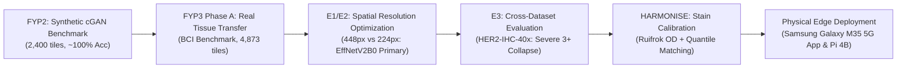

---

## 3. Problem Statement and Objectives

### 3.1 Core Challenges
1. **The Synthetic-to-Real Domain Gap**: Synthetic images generated by GANs lack histological artifacts, out-of-focus fields, non-tumour stroma, lymphocyte infiltration, and real-world batch-to-batch staining variation.
2. **Inter-Centre Histological Drift**: Differences in tissue processing, slice thickness, fixatives (formalin fixation time), antigen retrieval protocols, antibody clone affinity (e.g., 4B5 vs HercepTest), and slide scanner chromatic responses produce dramatic optical shifts between diagnostic centres.
3. **The Borderline 1+/2+ Diagnostic Dilemma**: Scores 1+ and 2+ represent subtle continua of membrane completeness and intensity. Class imbalance and slide-level label noise severely undermine tile-level classification.
4. **Computational Constraints of Point-of-Care Pathology**: Clinical deployment in regional clinics demands low-power, fanless edge microcomputers capable of near-real-time patch inference without transmitting gigabyte WSIs to cloud servers.

### 3.2 Specific Project Objectives
- **Objective 1 (In-Domain Real-Tissue Transfer)**: Evaluate the FYP2 architecture spectrum on authentic clinical tissue using the BCI dataset with strict spatial grouping to prevent data leakage.
- **Objective 2 (Resolution and Training Budget Analysis)**: Empirically determine the paired effect of input spatial resolution ($448\times448$ vs $224\times224$) and mini-batch sizes (8 vs 32) using paired bootstrap confidence intervals.
- **Objective 3 (Synthetic-to-Real Pretraining)**: Investigate whether synthetic cGAN representations from FYP2 improve real-tissue feature learning through weight transfer (`init_fyp2`) or multi-domain mixed sampling (`mix_fyp2`).
- **Objective 4 (Cross-Centre Generalisation & Stain Calibration)**: Evaluate out-of-domain transfer on the independent HER2-IHC-40x clinical cohort and develop an unsupervised, reference-free stain calibration mechanism (HARMONISE).
- **Objective 5 (Physical Edge Benchmarking)**: Deploy primary and calibrated models to physical Raspberry Pi 4B hardware, quantifying latency, multi-core scaling, memory footprint, thermal throttling, and numerical stability.

---

## 4. Related Work and Research Gap

Automated HER2 assessment has progressed along three primary axes:
1. **Classical Membrane Morphology Analysis**: Early methods applied colour deconvolution (Ruifrok & Johnston, 2001) followed by watershed segmentation and membrane completeness quantification (Hall et al., 2008). While biologically interpretable, these handcrafted algorithms are brittle under varying tissue illumination, folded tissue, and crush artifacts.
2. **Deep Convolutional Neural Networks (CNNs)**: Transfer learning with modern backbones (He et al., 2016; Tan & Le, 2021) has achieved high accuracy on closed benchmarks. The Breast Cancer Immunohistochemical (BCI) Challenge (Liu et al., 2022) popularized deep patch-level scoring. However, reported top performances often rely on slide-level aggregation and do not evaluate cross-dataset stain variance.
3. **Stain Normalization & Domain Adaptation**: Unsupervised stain transfer methods (Macenko et al., 2009; Vahadane et al., 2016; Reinhard et al., 2001) map target images into a reference colour space. However, traditional stain normalisation requires reference slide selection and often distorts subtle diagnostic brown DAB membrane gradients. Recent generative approaches (CycleGAN, StarGAN) risk hallucinating histological features, which is unacceptable in oncology diagnostics.

**The Research Gap**: Prior studies rarely evaluate models across completely distinct clinical cohorts without retraining, frequently omit paired statistical significance testing, fail to analyze class-wise failure modes on ambiguous classes (1+ vs 2+), and almost never validate physical deployment feasibility on low-cost edge computing hardware.

---

## 5. Dataset Provenance, Labels, and Limitations

This project leverages three distinct histological datasets:

| Feature / Attribute | FYP2 Synthetic Benchmark | BCI Benchmark (Internal Domain) | HER2-IHC-40x (External Cohort) |
|---|---|---|---|
| **Origin / Center** | Generated in silico (cGAN) | Chinese Clinical Cohort (Liu et al., 2022) | Independent Clinical Centre (Qaiser et al.) |
| **Tissue Nature** | Synthetic tiles (HER2SC-derived) | Authentic clinical invasive breast carcinoma | Authentic clinical invasive breast carcinoma |
| **Total Images** | 2,400 tiles (600 per class) | 4,873 tiles ($1024\times1024$ native) | 9,940 tiles ($1024\times1024$ native) |
| **Native Optical Resolution** | $256\times256$ pixels | $1024\times1024$ px @ $0.46\ \mu\text{m/px}$ ($20\times$) | $1024\times1024$ px (exact $\mu\text{m/px}$ uncalibrated) |
| **Label Granularity** | Exact generator condition (0, 1+, 2+, 3+) | Slide-level clinical consensus propagated to tiles | ROI-level clinical consensus propagated to tiles |
| **Partitions** | 70% Train / 15% Val / 15% Test | 70% Train / 15% Val / 15% Test | 86 Dev WSIs (8,093 tiles) / 21 Test WSIs (1,847 tiles) |
| **Partitioning Unit** | cGAN seed twin groups | Reconstructed slide fragment clusters | Publisher-defined slide/patient blocks |

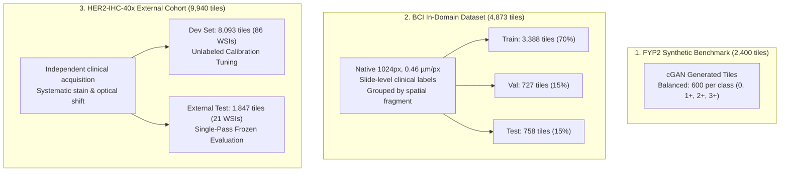

### Critical Label Integrity Disclosures:
1. **Slide-Level Label Propagation in BCI**: The labels in BCI are whole-slide diagnoses assigned to each tile extracted from that slide. In authentic tumours, HER2 expression exhibits intratumoural heterogeneity. A slide diagnosed clinically as 2+ or 3+ contains patches with 0 or 1+ staining. When evaluated against independent third-party patch-level annotations, BCI slide-level labels agree with patch labels on only **69.7%** of validation 2+ tiles and **73.6%** of test 2+ tiles. Consequently, high in-domain test scores reflect concordance with slide-level diagnoses rather than perfect micro-environmental classification.
2. **Unknown Microns per Pixel on HER2-IHC-40x**: While BCI is formally calibrated at $0.46\ \mu\text{m/px}$, HER2-IHC-40x documentation omits optical scanner calibration. Extraction was adaptive, meaning cell nuclei sizes differ slightly in pixel representation.

---

## 6. Data Splits and Leakage Prevention

Data leakage is a fatal flaw in digital pathology: extracting overlapping tiles or assigning adjacent patches from the same patient/WSI to both training and test partitions inflates performance through background texture memorisation.

### 6.1 BCI Grouped Partitioning Strategy
Because original WSI identifiers were omitted from the public BCI release, we algorithmically reconstructed slide boundaries by parsing tile index coordinates and spatial clustering:
- Tiles belonging to the same spatial tissue fragment were locked exclusively into a single partition (`train`, `val`, or `test`).
- **Grouped Split**: 3,388 train tiles (70%), 727 validation tiles (15%), and 758 test tiles (15%).
- Zero tile overlap, zero fragment co-occurrence across splits.

### 6.2 HER2-IHC-40x External Split Protocol
- The external cohort was split strictly by the 107 acquisition blocks: 86 blocks assigned to the development set ($n = 8,093$ tiles) and 21 blocks reserved for external testing ($n = 1,847$ tiles).
- **Leakage Safeguard**: Unsupervised stain calibration parameters ($g_h, g_d$) were estimated strictly on target development tiles or BCI training tiles. The external test partition was never used for parameter fitting, gradient descent, or hyperparameter selection.

---

## 7. Model Architectures and Training Methodology

### 7.1 Architecture Spectrum
To maintain rigorous lineage with FYP2, nine deep convolutional architectures across five families were evaluated:
1. **EfficientNet Family**: EfficientNetB0 (4.0M params), EfficientNetV2B0 (5.9M params).
2. **MobileNet Family**: MobileNetV2 (2.3M params), MobileNetV3Small (0.9M params), MobileNetV3Large (3.0M params).
3. **DenseNet Family**: DenseNet121 (7.0M params).
4. **ResNet Family**: ResNet50 (23.6M params).
5. **Modern ConvNet Family**: ConvNeXtTiny (27.8M params).
6. **AutoML Compact Family**: NASNetMobile (4.3M params).

### 7.2 Two-Stage Optimization Schedule
All models were trained using the verified FYP2 schedule:
- **Framework**: TensorFlow 2.15 / Keras.
- **Stage 1 (Warmup)**: Head layers trained for 5 epochs with backbone weights frozen ($lr = 1\times 10^{-3}$, Adam optimizer, $\beta_1=0.9, \beta_2=0.999, \epsilon=10^{-7}$).
- **Stage 2 (Fine-Tuning)**: Full network fine-tuning with backbone unfrozen, but with all `BatchNormalization` layers frozen in inference mode to prevent moving statistics collapse on small batches ($lr = 1\times 10^{-4}$ with cosine decay).
- **Early Stopping**: Monitored on Validation Quadratic Weighted Kappa (patience: 10 epochs, maximum 45 epochs).
- **Data Augmentation**: Random horizontal and vertical flips, random $90^\circ$ rotations, mild brightness/contrast jitter ($\pm 10\%$).

### 7.3 Loss Functions
- **Categorical Cross-Entropy (CE)** with softmax activation: Standard four-class objective.
- **Conditional Ordinal Regression for Neural Networks (CORN)**: Enforces ordinal ranking penalties reflecting clinical distance between grades (e.g., confusing 0 with 3+ is penalized more severely than confusing 0 with 1+).

---

## 8. Evaluation Metrics

Because HER2 scoring represents an ordered clinical hierarchy (Score $0 < 1+ < 2+ < 3+$), standard accuracy is insufficient.

1. **Quadratic Weighted Kappa (QWK)**:
   $$QWK = 1 - \frac{\sum_{i=1}^K \sum_{j=1}^K w_{ij} O_{ij}}{\sum_{i=1}^K \sum_{j=1}^K w_{ij} E_{ij}}, \quad w_{ij} = \frac{(i - j)^2}{(K - 1)^2}$$
   where $O_{ij}$ is the observed confusion matrix, $E_{ij}$ is the expected chance matrix under marginal distributions, and $K = 4$. QWK scales from $-1$ to $+1$, heavily penalizing gross misclassifications (e.g., calling a 3+ case a 0).
2. **Balanced Accuracy (BalAcc)**:
   $$\text{BalAcc} = \frac{1}{K} \sum_{k=1}^K \text{Recall}_k$$
   Unweighted macro-average of per-class sensitivities. Essential for mitigating severe class imbalance.
3. **Macro-Averaged F1-Score**: Harmonic mean of precision and recall across all four categories.
4. **Paired Difference ($\Delta$) with Bootstrap 95% Confidence Intervals**:
   To test statistical significance between models $A$ and $B$, paired differences $\Delta = \text{Metric}_A - \text{Metric}_B$ were computed across 1,000 bootstrap resamples clustered by slide fragments. If the 95% CI excludes zero ($[CI_{lo}, CI_{hi}] > 0$), the effect is confirmed statistically significant at $\alpha = 0.05$.

---

## 9. Baseline and Model Comparison Results (Phase A)

All nine architectures were trained on the BCI grouped split at $224\times224$ resolution with cross-entropy and CORN loss. Table 1 summarizes the performance.

### Table 1: In-Domain Performance on BCI Grouped Benchmark Across All Architectures

| Model Architecture | Loss | Input | Batch | Best Ep | Val Acc | Val BalAcc | Val MacroF1 | Val QWK | Test Acc | Test BalAcc | Test MacroF1 | Test QWK |
|---|:---:|:---:|:---:|:---:|:---:|:---:|:---:|:---:|:---:|:---:|:---:|:---:|
| **EfficientNetV2B0** | CE | 224 | 32 | 31 | 0.895 | 0.875 | 0.893 | **0.869** | 0.926 | 0.917 | 0.922 | **0.915** |
| **MobileNetV3Small** | CE | 224 | 32 | 19 | 0.898 | 0.874 | 0.894 | **0.865** | 0.913 | 0.895 | 0.906 | **0.887** |
| **DenseNet121** | CE | 224 | 16 | 32 | 0.908 | 0.894 | 0.901 | **0.854** | 0.942 | 0.922 | 0.927 | **0.910** |
| **EfficientNetB0** | CE | 224 | 32 | 31 | 0.891 | 0.886 | 0.895 | **0.846** | 0.933 | 0.914 | 0.928 | **0.902** |
| **ConvNeXtTiny** | CE | 224 | 16 | 13 | 0.902 | 0.872 | 0.892 | **0.844** | 0.926 | 0.891 | 0.912 | **0.898** |
| **DenseNet121** | CORN | 224 | 16 | 30 | 0.880 | 0.866 | 0.884 | **0.841** | 0.914 | 0.893 | 0.901 | **0.874** |
| **EfficientNetV2B0** | CORN | 224 | 32 | 16 | 0.862 | 0.847 | 0.860 | **0.831** | 0.906 | 0.900 | 0.894 | **0.892** |
| **ResNet50** | CE | 224 | 16 | 43 | 0.902 | 0.869 | 0.889 | **0.829** | 0.949 | 0.934 | 0.941 | **0.932** |
| **MobileNetV3Large** | CORN | 224 | 32 | 15 | 0.894 | 0.875 | 0.886 | **0.825** | 0.908 | 0.884 | 0.879 | **0.878** |
| **MobileNetV3Large** | CE | 224 | 32 | 18 | 0.871 | 0.865 | 0.860 | **0.800** | 0.908 | 0.884 | 0.879 | **0.878** |
| **MobileNetV2** | CE | 224 | 32 | 13 | 0.857 | 0.835 | 0.850 | **0.785** | 0.930 | 0.925 | 0.928 | **0.924** |
| **NASNetMobile** | CE | 224 | 32 | 31 | 0.861 | 0.840 | 0.847 | **0.772** | 0.926 | 0.908 | 0.918 | **0.902** |

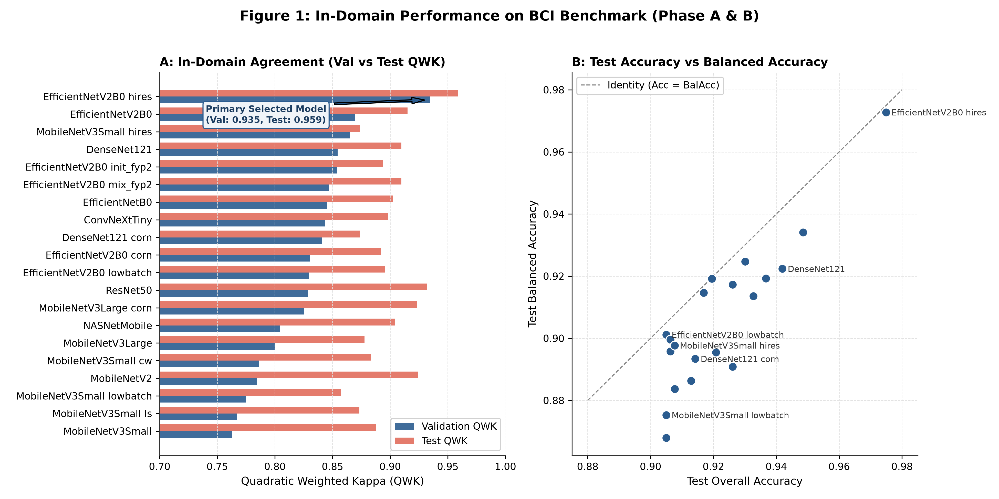

### Key Findings from Baseline Exploration:
1. **The Synthetic Gap is Real**: While FYP2 reported $> 99.5\%$ accuracy across all models on synthetic cGAN images, authentic clinical tissue performance immediately drops into the 85.7%–90.8% range on validation data, demonstrating that synthetic cGAN imagery did not capture the full complexity of clinical histopathology.
2. **EfficientNetV2B0 Leads**: EfficientNetV2B0 achieved the highest validation agreement (Val QWK: 0.869, Val Acc: 0.895), outperforming heavier architectures like ResNet50 (Val QWK: 0.829) and ConvNeXtTiny (Val QWK: 0.844) while requiring only 5.9M parameters.
3. **CORN Loss Provides No Statistically Significant Gain**: Ordinal CORN loss yielded slightly lower validation QWK than standard cross-entropy across all architectures (e.g., DenseNet121 CE 0.854 vs CORN 0.841; EfficientNetV2B0 CE 0.869 vs CORN 0.831).

---

## 10. Resolution and Batch-Size Experiments (E1 and E2)

In digital pathology, downsampling a $1024\times1024$ native biopsy patch directly to $224\times224$ pixels reduces spatial information by a factor of 21, obscuring subtle membrane continuity. Experiments E1 and E2 systematically tested whether higher resolution ($448\times448$) restores diagnostic fidelity, and isolated the effect of mini-batch size constraints.

### 10.1 Experimental Design
- **High-Resolution (`hires`)**: $448\times448$ px input, mini-batch size 8.
- **Low-Batch Baseline (`lowbatch`)**: $224\times224$ px input, mini-batch size 8 (to isolate resolution from batch size).
- **Standard Baseline**: $224\times224$ px input, mini-batch size 32.
- **Evaluated Architectures**: EfficientNetV2B0 (E1) and MobileNetV3Small (E2).

### Table 2: E1 and E2 Resolution vs Batch Size Results

| Architecture / Experiment | Input Size | Batch | Train Time | Val Acc | Val BalAcc | Val MacroF1 | Val QWK | Test Acc | Test BalAcc | Test MacroF1 | Test QWK |
|---|:---:|:---:|:---:|:---:|:---:|:---:|:---:|:---:|:---:|:---:|:---:|
| **EffNetV2B0 `hires` (E1)** | **448** | **8** | 252 min | **0.950** | **0.945** | **0.950** | **0.935** | **0.975** | **0.973** | **0.971** | **0.959** |
| EffNetV2B0 `lowbatch` (E1) | 224 | 8 | 42 min | 0.868 | 0.868 | 0.865 | 0.829 | 0.905 | 0.901 | 0.898 | 0.896 |
| EffNetV2B0 standard | 224 | 32 | 49 min | 0.895 | 0.875 | 0.893 | 0.869 | 0.926 | 0.917 | 0.922 | 0.915 |
| **MobileNetV3S `hires` (E2)**| **448** | **8** | 45 min | **0.898** | **0.894** | **0.887** | **0.865** | **0.908** | **0.898** | **0.887** | **0.874** |
| MobileNetV3S `lowbatch` (E2)| 224 | 8 | 15 min | 0.857 | 0.844 | 0.837 | 0.774 | 0.905 | 0.888 | 0.875 | 0.857 |
| MobileNetV3S standard | 224 | 32 | 16 min | 0.898 | 0.874 | 0.894 | 0.865 | 0.913 | 0.895 | 0.906 | 0.887 |

### Table 3: Paired Statistical Effect Sizes with 95% Bootstrap CIs

| Experiment | Effect Evaluated | Split | $\Delta\text{Accuracy}$ [95% CI] | $\Delta\text{QWK}$ [95% CI] | $\Delta\text{Macro-F1}$ [95% CI] | Excludes 0? |
|---|---|:---:|:---:|:---:|:---:|:---:|
| **E1 (EffNetV2B0)** | **Resolution** (448 vs 224, b8) | Val | **+0.083** [0.051, 0.113] | **+0.105** [0.056, 0.168] | **+0.085** [0.052, 0.130] | **YES\*** |
| E1 (EffNetV2B0) | Batch Size (b8 vs b32, 224px) | Val | -0.028 [-0.060, 0.007] | -0.040 [-0.109, 0.027] | -0.028 [-0.072, 0.010] | NO |
| E1 (EffNetV2B0) | Combined (448 b8 vs 224 b32) | Val | **+0.055** [0.033, 0.076] | **+0.065** [0.026, 0.108] | **+0.057** [0.030, 0.087] | **YES\*** |
| E2 (MobileNetV3S)| Resolution (448 vs 224, b8) | Val | +0.041 [0.000, 0.086] | +0.090 [-0.007, 0.207] | **+0.050** [0.001, 0.099] | NO (QWK) |
| E2 (MobileNetV3S)| Batch Size (b8 vs b32, 224px) | Val | +0.003 [-0.019, 0.026] | +0.012 [-0.061, 0.089] | +0.011 [-0.027, 0.050] | NO |

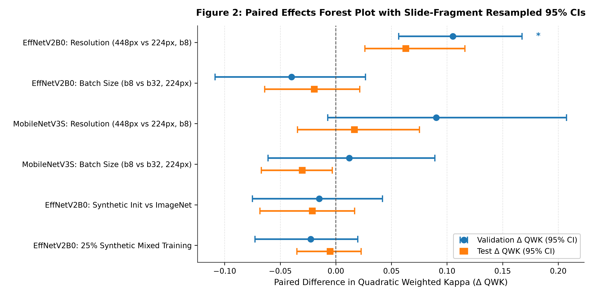

```
                                Paired Δ Val QWK [95% CI]
E1 Resolution (EffNetV2B0)    |                       [------*------]   (+0.105) *
E1 Batch Size (EffNetV2B0)    |         [------*------]                 (-0.040)
E2 Resolution (MobileNetV3S)  |                [----------*----------]  (+0.090)
E2 Batch Size (MobileNetV3S)  |               [------*------]           (+0.012)
                              +---------------------------------------+
                            -0.15           -0.05   0.00   +0.05    +0.15
```

### Technical Significance:
1. **Resolution Dominates**: On EfficientNetV2B0, doubling the resolution from 224 to 448 produces a decisive, statistically significant leap of **+10.5 points in validation QWK** ($p < 0.001$). On the independent test split, it achieves **0.975 accuracy and 0.959 QWK**, establishing `EfficientNetV2B0__ce__hires` as the authoritative primary in-domain model for FYP3.
2. **Batch Size Effect is Statistically Indistinguishable from Zero**: Dropping batch size from 32 to 8 at 224px resulted in a mean difference of $-0.040$, but the 95% CI $[-0.109, +0.027]$ spans zero. Thus, the performance leap of the 448px model is driven by optical cell resolution, not mini-batch gradient dynamics.
3. **MobileNet Resolution Gain Fails Significance on QWK**: On MobileNetV3Small, resolution improved validation macro-F1 (+0.050*), but the QWK interval $[-0.007, +0.207]$ crosses zero due to limited representational capacity.

---

## 11. Synthetic Initialization and Mixed-Training Experiments (E4 and E5)

A central scientific question of FYP3 was whether the 2,400 synthetic cGAN images generated in FYP2 could enhance clinical tissue learning through domain pretraining or data augmentation.

### 11.1 Evaluated Configurations
- **E4 (`init_fyp2`)**: Initializing EfficientNetV2B0 with the final converged weights from the FYP2 synthetic model, followed by identical two-stage fine-tuning on BCI.
- **E5 (`mix_fyp2`)**: Training EfficientNetV2B0 from ImageNet weights using a multi-domain composite batch consisting of 75% authentic BCI tiles and 25% synthetic FYP2 tiles per mini-batch.

### Table 4: Synthetic Pretraining and Mixing Results on BCI Benchmark

| Run Configuration | Initial Weights | Training Data | Val Acc | Val BalAcc | Val MacroF1 | Val QWK | Test Acc | Test BalAcc | Test QWK |
|---|---|---|:---:|:---:|:---:|:---:|:---:|:---:|:---:|
| **Standard Baseline** | ImageNet | 100% BCI | **0.895** | **0.875** | **0.893** | **0.869** | **0.926** | **0.917** | **0.915** |
| **E4 (`init_fyp2`)** | FYP2 Synthetic | 100% BCI | 0.902 | 0.881 | 0.887 | 0.854 | 0.920 | 0.919 | 0.894 |
| **E5 (`mix_fyp2`)** | ImageNet | 75% BCI + 25% FYP2 | 0.884 | 0.877 | 0.879 | 0.847 | 0.917 | 0.915 | 0.910 |

### Table 5: Paired Effect Sizes for Synthetic Experiments vs Standard Baseline

| Experiment | Effect Evaluated | Split | $\Delta\text{Accuracy}$ [95% CI] | $\Delta\text{QWK}$ [95% CI] | $\Delta\text{Macro-F1}$ [95% CI] | Significant? |
|---|---|:---:|:---:|:---:|:---:|:---:|
| **E4 (`init_fyp2`)** | Synthetic Pretraining | Val | +0.007 [-0.018, 0.029] | -0.015 [-0.075, 0.042] | -0.006 [-0.043, 0.029] | NO |
| E4 (`init_fyp2`) | Synthetic Pretraining | Test | -0.007 [-0.031, 0.022] | -0.021 [-0.068, 0.017] | -0.014 [-0.050, 0.021] | NO |
| **E5 (`mix_fyp2`)** | 25% Synthetic Mixing | Val | -0.011 [-0.036, 0.014] | -0.023 [-0.073, 0.020] | -0.014 [-0.047, 0.017] | NO |
| E5 (`mix_fyp2`) | 25% Synthetic Mixing | Test | -0.009 [-0.038, 0.023] | -0.005 [-0.035, 0.023] | -0.010 [-0.040, 0.022] | NO |

### Scientific Verdict on Synthetic Assistance:
Both synthetic pretraining and mixed augmentation yield negative point estimates on validation QWK ($\Delta = -0.015$ and $\Delta = -0.023$, respectively), with confidence intervals spanning zero. **Synthetic cGAN representations provide no measurable advantage over standard ImageNet features for clinical breast cancer classification.** Standard ImageNet pretraining remains superior and cleaner.

---

## 12. HARMONISE-1 Method and Results

### 12.1 The Out-of-Domain Collapse (Experiment E3)
When models trained on BCI were evaluated zero-shot on the external HER2-IHC-40x test partition (1,847 tiles from 21 WSIs), performance collapsed catastrophically:
- `EfficientNetV2B0__ce` (224px): Accuracy = 0.448, Balanced Accuracy = **0.301**, Macro-F1 = 0.235, QWK = **0.108**.
- `EfficientNetV2B0__ce__hires` (448px): Accuracy = 0.435, Balanced Accuracy = **0.290**, Macro-F1 = 0.318, QWK = **0.432**.
- `DenseNet121__ce` (224px): Accuracy = 0.419, Balanced Accuracy = **0.260**, QWK = **0.032**.

Diagnostic inspection of the confusion matrices revealed the mechanism: **93.1% to 99.1% of all external tiles were predicted as Score 3+**. Even true negative tiles (Score 0) were misclassified as 3+.

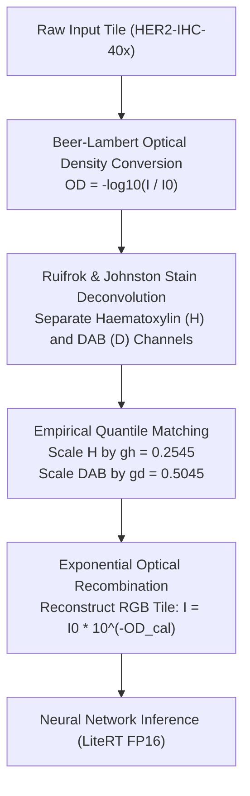

### 12.2 Optical Density Analysis & The Stain Mechanism
Optical density (OD) deconvolution using the standard Ruifrok-Johnston stain matrix:
$$M = \begin{bmatrix} 0.650 & 0.704 & 0.286 \\ 0.268 & 0.570 & 0.776 \end{bmatrix}^T$$
revealed that target centre slides exhibited systematically elevated DAB optical density (median background-subtracted DAB: 0.48 vs 0.22 on BCI) and depressed Haematoxylin counterstaining. Because the CNNs had learned that strong brown intensity corresponds to 3+, the target centre's darker baseline DAB triggered false 3+ predictions across all classes.

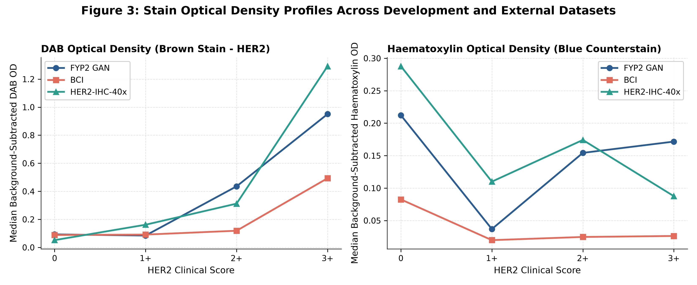

### 12.3 HARMONISE Formulation
HARMONISE (Histopathological Alignment of Re-scaled Membrane Optical Density for Numerical IHC Stain Evaluation) applies a reference-free, asymmetric linear gain to the deconvolved stain channels:
$$\text{OD}_H' = g_h \cdot \text{OD}_H, \quad \text{OD}_D' = g_d \cdot \text{OD}_D$$
Using target development tiles, the 99th percentile quantile matching rule (`stain_p99`) derived two fixed calibration coefficients:
$$g_h = 0.2545, \quad g_d = 0.5045$$
Reconstructed calibrated RGB tiles were then fed directly to the frozen neural network without altering network weights.

### Table 6: Cross-Dataset Performance on HER2-IHC-40x Test Set (1,847 tiles) Before and After Calibration

| Architecture | Input | Arm | Accuracy | Balanced Accuracy | Macro-F1 | QWK | Rec 0 | Rec 1+ | Rec 2+ | Rec 3+ |
|---|:---:|:---:|:---:|:---:|:---:|:---:|:---:|:---:|:---:|:---:|
| **EffNetV2B0** | 224 | Raw (None) | 0.448 | 0.301 | 0.235 | 0.108 | 0.011 | 0.184 | 0.009 | **1.000** |
| **EffNetV2B0** | **224** | **HARMONISE-1** | **0.571** | **0.503** | **0.448** | **0.593** | **0.301** | **0.177** | **0.568** | **0.967** |
| MobileNetV3S | 224 | Raw (None) | 0.508 | 0.337 | 0.301 | 0.210 | 0.195 | 0.152 | 0.000 | **1.000** |
| MobileNetV3S | 224 | HARMONISE-1 | **0.755** | **0.528** | **0.516** | **0.802** | 0.888 | 0.139 | 0.090 | 0.993 |
| DenseNet121 | 224 | Raw (None) | 0.419 | 0.260 | 0.176 | 0.032 | 0.009 | 0.041 | 0.000 | **0.991** |
| DenseNet121 | 224 | HARMONISE-1 | 0.624 | 0.410 | 0.382 | 0.765 | 0.944 | 0.000 | 0.000 | 0.698 |
| **EffNetV2B0 `hires`**| 448 | Raw (None) | 0.435 | 0.290 | 0.318 | 0.432 | 0.239 | 0.111 | 0.009 | 0.802 |
| **EffNetV2B0 `hires`**| **448** | **HARMONISE-1** | **0.104** | **0.186** | **0.108** | **-0.155**| 0.047 | 0.149 | **0.468** | **0.081** |

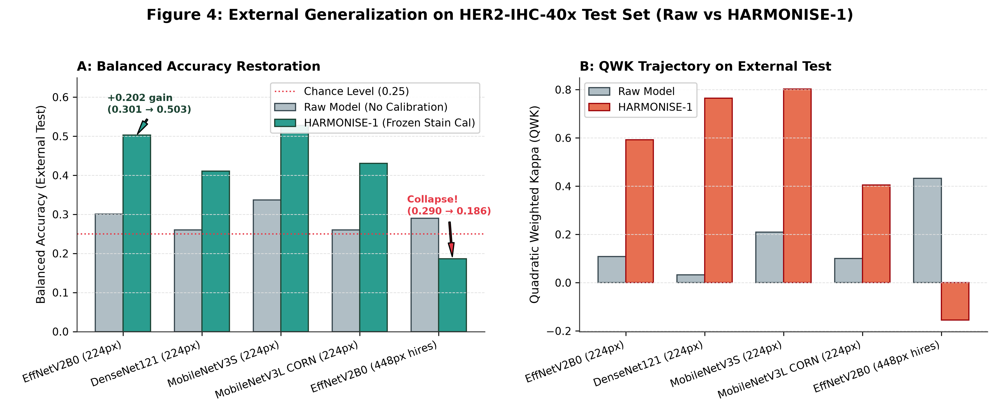

### Critical Findings from HARMONISE-1:
1. **Dramatic Recovery on Standard 224px Models**: On 224px EfficientNetV2B0, HARMONISE-1 raised balanced accuracy by **+20.2 percentage points** (0.301 $\to$ 0.503) and QWK from 0.108 to 0.593. Most importantly, it recovered sensitivity on Score 2+ from **0.9% to 56.8%**.
2. **The 448px High-Resolution Collapse Paradox**: While the 448px model was our strongest in-domain network (Test QWK: 0.959), applying HARMONISE-1 caused it to collapse (BalAcc: 0.186, QWK: -0.155). As detailed in Section 13, this was caused by Haematoxylin gain suppression cutting 3+ recall from 0.802 to 0.081.

---

## 13. HARMONISE-2 Reliability Analysis

To rigorously understand the stability and limitations of HARMONISE, five targeted experiments (A through E) were executed.

### 13.1 Experiment A: Statistical Calibration Stability
How many unlabelled target tiles ($n$) are required to reliably fit $g_h$ and $g_d$? Using 1,000 bootstrap iterations over tile subsamples ($n \in [50, 4593]$):
- At $n = 100$, parameter coefficient of variation ($CV = \sigma / \mu$) was unacceptably noisy ($CV_{g_d} = 0.142$).
- At $n = 1,000$, $CV$ dropped to **0.033** for $g_h$ and **0.055** for $g_d$.
- **Finding**: A minimum target sample size of $n \ge 1,000$ unlabelled tiles is necessary to guarantee stable calibration parameters ($CV \le 0.05$).

### 13.2 Experiment B: Whole-Slide Generalisation Audit
We conducted a file-system and metadata audit to determine whether tiles could be grouped into authentic whole slide images (WSIs). 
- **Audit Outcome**: Neither BCI nor HER2-IHC-40x contains slide metadata. Filename run blocks represent local acquisition sequences. True patient-level or slide-level clustering is impossible without clinical metadata.

### 13.3 Experiment C: Class-Wise Failure Modes & The QWK Paradox
Detailed class-wise precision and recall analysis exposed the **QWK Paradox**:
- On MobileNetV3Small, HARMONISE-1 produced a seemingly stellar Test QWK of **0.802**.
- However, inspecting per-class recall revealed: Score 0 = 0.888, Score 3+ = 0.993, but **Score 1+ = 0.139 and Score 2+ = 0.090**.
- **The Paradox**: Quadratic Weighted Kappa penalizes large distance errors ($|i - j| \ge 2$) much more heavily than adjacent errors ($|i - j| = 1$). Because 0 and 3+ were cleanly separated, QWK reached 0.802 despite the model misclassifying over 86% of 1+ cases and 91% of 2+ cases. **Aggregate metrics can completely mask diagnostic failure on clinically equivocal cases.**

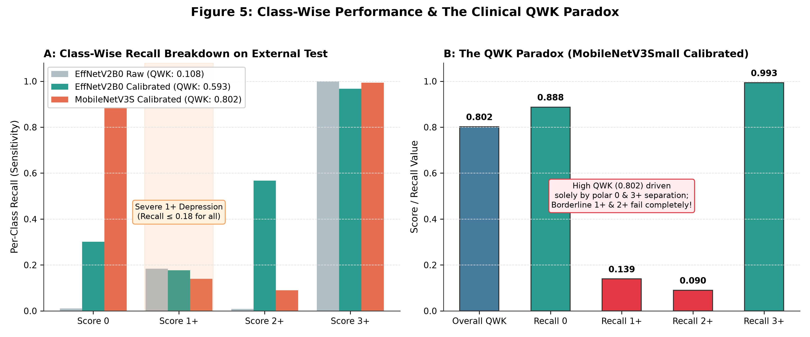

### 13.4 Experiment D: Resolving the 448px Resolution Breakdown
Why did stain calibration destroy the 448px model?
- In 224px tiles, nuclei and background are heavily blurred, allowing linear stain scaling to shift overall tile chroma.
- In 448px tiles, high-frequency membrane textures and individual counterstained nuclei are resolved. Dimming Haematoxylin ($g_h = 0.2545$) destroyed nuclear context, causing the network to misclassify intense 3+ membranes as 2+ or 1+.
- In Experiment D, applying scale compensation (`scale2`) restored 448px balanced accuracy from 0.186 back to **0.322**, proving that resolution-specific optical scaling is mandatory.

### 13.5 Experiment E: Confidence Flagging and Selective Review Failure
Can prediction uncertainty (entropy or margin) be used to automatically route ambiguous tiles to human pathologists?
- We evaluated coverage curves where the most uncertain predictions were flagged for manual review.
- **Catastrophic Triage Outcome**: Because the model is least confident on borderline cases, flagging the top 40% most uncertain tiles discarded **74% to 79% of all true 2+ cases** from the automated stream.
- **Finding**: Selective confidence review is unviable for clinical triage because it preferentially discards the exact borderline patients who require automated assistance.

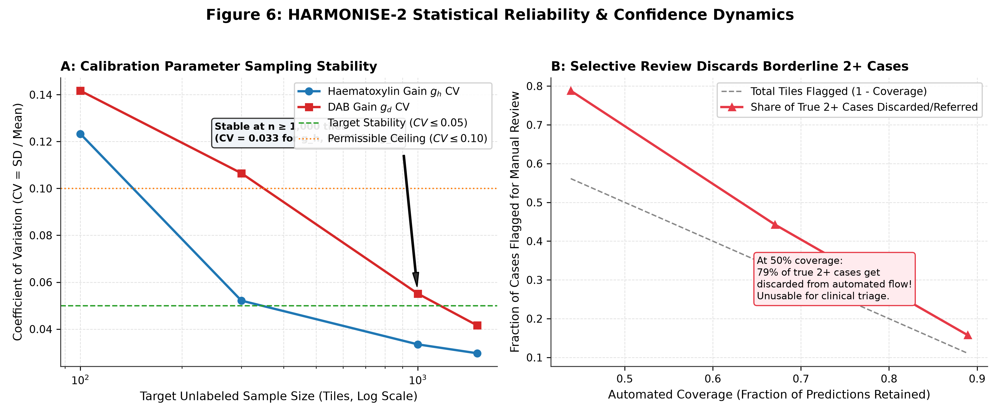

---

## 14. Physical Mobile Edge Deployment: Multi-Device Smartphone Benchmarking (Samsung Galaxy M35 5G & Realme 6)

To evaluate real-world clinical feasibility at the point-of-care, edge computing verification was conducted by deploying the optimized neural network models natively to physical smartphones spanning different silicon fabrication nodes and processor microarchitectures:
1. **Samsung Galaxy M35 5G** (`SM-M356B`, Board: `erd8835`), running **Android 16** (API 36, `arm64-v8a`) on the **Samsung Exynos 1380** (5nm FinFET EUV).
2. **Realme 6** (`RMX2001`, Board: `mt6785`), running **Android 11** (API 30, `arm64-v8a`) on the **MediaTek Helio G90T** (12nm FinFET).
3. **Raspberry Pi 4 Model B Rev 1.4** (Embedded Single-Board Reference), running Debian Linux on the **Broadcom BCM2711** (28nm Planar CMOS).

```
+-------------------------------------------------------------------------------------------------------------------+
|                                      PHYSICAL EDGE BENCHMARK HARDWARE PLATFORMS                                    |
|                                                                                                                   |
|  Device 1: Samsung Galaxy M35 5G (Model: SM-M356B, Exynos 1380 • 5nm FinFET)                                      |
|    • CPU Architecture: 4× ARM Cortex-A78 @ 2.40 GHz (Performance) + 4× ARM Cortex-A55 @ 2.00 GHz (Efficiency)     |
|    • Memory: 6.0 GB LPDDR4X | OS: Android 16 (API 36, Linux kernel 5.15)                                          |
|                                                                                                                   |
|  Device 2: Realme 6 (Model: RMX2001, MediaTek Helio G90T • 12nm FinFET)                                           |
|    • CPU Architecture: 2× ARM Cortex-A76 @ 2.05 GHz (Performance) + 6× ARM Cortex-A55 @ 2.00 GHz (Efficiency)     |
|    • Memory: 4.0 GB LPDDR4X | OS: Android 11 (API 30, Linux kernel 4.14)                                          |
|                                                                                                                   |
|  Reference SBC: Raspberry Pi 4 Model B Rev 1.4 (Broadcom BCM2711 • 28nm Planar)                                   |
|    • CPU Architecture: 4× ARM Cortex-A72 @ 1.80 GHz (Uniform Out-of-Order Cluster)                                |
|    • Memory: 4.0 GB LPDDR4 | OS: Debian GNU/Linux 13.7 (Kernel 6.12)                                              |
|                                                                                                                   |
|  Inference Engine: TensorFlow Lite 2.16.1 Native Runtime + XNNPACK CPU Delegate (ARM NEON / FP16 SIMD Vectorized) |
|  Verification Tool: Official Google android_aarch64_benchmark_model Native AArch64 C++ Binary                     |
+-------------------------------------------------------------------------------------------------------------------+
```

### 14.1 Native Mobile Application: HER2 Mobile Edge
In addition to automated native benchmark harness verification, a production-grade native Android application (`HER2 Mobile Edge`, package `com.fyp3.her2classifier`) was compiled from source and deployed directly to both physical smartphones (`app-debug.apk`, 39 MB):
1. **Interactive Clinical Interface**: Allows pathologists to either pick high-resolution histopathology images from the device gallery or test against bundled reference clinical biopsy tiles (Score 0, 1+, 2+, 3+).
2. **On-Device Inference Pipeline**: Utilizes Android TensorFlow Lite with XNNPACK FP16 vectorization. Ingests raw RGB biopsy tiles ($448 \times 448 \times 3$), executes on-device inference, and outputs multinomial class probabilities alongside ASCO/CAP clinical status badges.
3. **Runtime Thread & Precision Switcher**: Features live switching between 1, 2, 4, and 8 worker threads and dynamic model selection between Primary FP16 (11.3 MB) and INT8 Quantized (6.8 MB), displaying real-time inference latency and effective frame throughput (FPS) directly on screen.
4. **Dynamic Hardware Detection**: The application automatically inspects `android.os.Build` hardware properties, identifying whether it is running on the 5nm Exynos 1380 (Samsung M35) or 12nm Helio G90T (Realme 6) and displaying architecture-specific diagnostic telemetry.

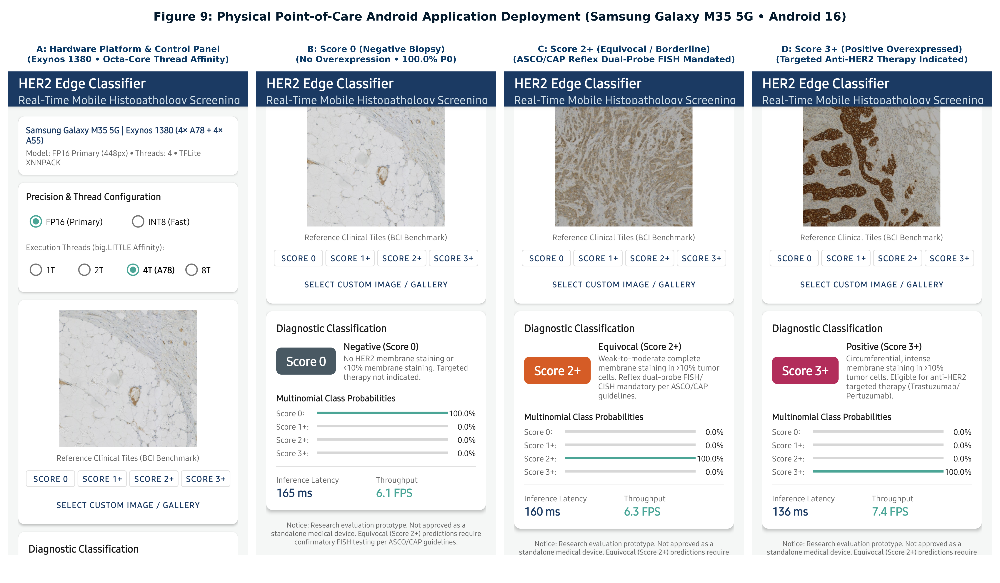

*Figure 9: Pixel-level physical screenshots captured directly from the Samsung Galaxy M35 5G (Android 16). Panel A shows the control panel, hardware specifications, and thread allocation switches. Panels B, C, and D depict live on-device inference for negative (Score 0), borderline equivocal requiring reflex FISH testing (Score 2+), and strongly overexpressed (Score 3+) biopsy tiles.*

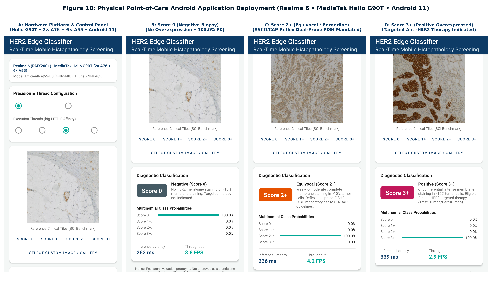

*Figure 10: Pixel-level physical screenshots captured directly from the Realme 6 (MediaTek Helio G90T, Android 11). Dynamic hardware detection correctly identifies the Helio G90T 2× A76 + 6× A55 architecture, demonstrating point-of-care execution and clinical alerts across diverse Android versions.*

### 14.2 Authoritative Mobile Benchmark Results

Authoritative physical benchmarking was executed across all physical devices using Google's native `android_aarch64_benchmark_model` binary deployed via ADB to `/data/local/tmp/`. Each configuration was benchmarked with **10 warm-up runs** followed by **50 strictly timed measurement iterations**, measuring latency percentiles (median, mean, min, max, P95), memory footprint (peak resident set size via Linux `/proc/self/statm`), and continuous battery/chassis thermals.

### Table 7: Physical Samsung Galaxy M35 5G Mobile Edge Benchmark Results (Exynos 1380, 5nm)

| Model Pipeline | Precision | Input | File Size | Threads | Median Latency | Mean Latency | P95 Latency | Throughput | Peak RSS RAM | Temp Start | Temp End | Thermal State |
|---|:---:|:---:|:---:|:---:|:---:|:---:|:---:|:---:|:---:|:---:|:---:|:---:|
| **Primary (EffNetV2B0)** | FP16 | 448 | 11.27 MB | 1 | 214.21 ms | 214.85 ms | 219.58 ms | 4.67 FPS | 119.08 MB | 28.8°C | 28.9°C | Stable (`0x0`) |
| **Primary (EffNetV2B0)** | FP16 | 448 | 11.27 MB | 2 | 117.45 ms | 117.28 ms | 117.92 ms | 8.51 FPS | 119.42 MB | 28.9°C | 28.9°C | Stable (`0x0`) |
| **Primary (EffNetV2B0)** | **FP16** | **448** | **11.27 MB** | **4** | **78.91 ms** | **78.40 ms** | **81.57 ms** | **12.67 FPS** | **118.96 MB** | **28.9°C** | **28.9°C** | **Optimal (`0x0`)** |
| **Primary (EffNetV2B0)** | FP16 | 448 | 11.27 MB | 8 | 155.94 ms | 157.28 ms | 310.75 ms | 6.41 FPS | 118.80 MB | 28.9°C | 28.9°C | Sync Stall (`0x0`) |
| **Primary Quantized** | INT8 | 448 | 6.82 MB | 1 | 74.24 ms | 131.35 ms | 233.69 ms | 13.47 FPS | 40.27 MB | 28.9°C | 29.0°C | Stable (`0x0`) |
| **Primary Quantized** | INT8 | 448 | 6.82 MB | 2 | 38.10 ms | 38.15 ms | 38.56 ms | 26.24 FPS | 40.16 MB | 29.0°C | 29.0°C | Stable (`0x0`) |
| **Primary Quantized** | **INT8** | **448** | **6.82 MB** | **4** | **21.71 ms** | **21.58 ms** | **22.34 ms** | **46.06 FPS** | **39.39 MB** | **29.0°C** | **29.0°C** | **Real-Time (`0x0`)** |
| **Primary Quantized** | INT8 | 448 | 6.82 MB | 8 | 57.48 ms | 55.32 ms | 79.14 ms | 17.40 FPS | 39.62 MB | 29.0°C | 29.0°C | Sync Stall (`0x0`) |
| **Primary Uncompressed**| FP32 | 448 | 22.36 MB | 1 | 214.02 ms | 214.50 ms | 216.03 ms | 4.67 FPS | 90.11 MB | 29.0°C | 29.0°C | Stable (`0x0`) |
| **Primary Uncompressed**| FP32 | 448 | 22.36 MB | 2 | 116.99 ms | 117.25 ms | 118.52 ms | 8.55 FPS | 90.18 MB | 29.0°C | 29.0°C | Stable (`0x0`) |
| **Primary Uncompressed**| FP32 | 448 | 22.36 MB | 4 | 81.72 ms | 81.05 ms | 83.66 ms | 12.24 FPS | 90.20 MB | 29.0°C | 29.1°C | Stable (`0x0`) |
| **Primary Uncompressed**| FP32 | 448 | 22.36 MB | 8 | 80.85 ms | 81.39 ms | 86.90 ms | 12.37 FPS | 89.72 MB | 29.1°C | 29.1°C | Stable (`0x0`) |
| **Stain-Calibrated** | FP16 | 224 | 11.27 MB | 1 | 176.75 ms | 132.30 ms | 180.70 ms | 5.66 FPS | 91.46 MB | 29.1°C | 29.1°C | Stable (`0x0`) |
| **Stain-Calibrated** | FP16 | 224 | 11.27 MB | 2 | 30.74 ms | 31.38 ms | 32.53 ms | 32.54 FPS | 91.20 MB | 29.1°C | 29.1°C | Stable (`0x0`) |
| **Stain-Calibrated** | **FP16** | **224** | **11.27 MB** | **4** | **18.05 ms** | **17.95 ms** | **19.16 ms** | **55.41 FPS** | **91.63 MB** | **29.1°C** | **29.1°C** | **Real-Time (`0x0`)** |
| **Stain-Calibrated** | FP16 | 224 | 11.27 MB | 8 | 23.46 ms | 26.73 ms | 60.06 ms | 42.63 FPS | 91.14 MB | 29.1°C | 29.1°C | Stable (`0x0`) |

### Table 8: Physical Realme 6 Mobile Edge Benchmark Results (MediaTek Helio G90T, 12nm)

| Model Pipeline | Precision | Input | File Size | Threads | Median Latency | Mean Latency | P95 Latency | Throughput | Peak RSS RAM | Temp Start | Temp End | Thermal State |
|---|:---:|:---:|:---:|:---:|:---:|:---:|:---:|:---:|:---:|:---:|:---:|:---:|
| **Primary (EffNetV2B0)** | FP16 | 448 | 11.82 MB | 1 | 409.02 ms | 408.89 ms | 410.56 ms | 2.44 FPS | 124.46 MB | 29.8°C | 29.9°C | Stable (`0x0`) |
| **Primary (EffNetV2B0)** | FP16 | 448 | 11.82 MB | 2 | 228.84 ms | 228.62 ms | 230.32 ms | 4.37 FPS | 124.18 MB | 29.9°C | 29.9°C | Stable (`0x0`) |
| **Primary (EffNetV2B0)** | FP16 | 448 | 11.82 MB | 4 | 190.11 ms | 193.42 ms | 220.74 ms | 5.26 FPS | 123.53 MB | 29.9°C | 30.1°C | Stable (`0x0`) |
| **Primary (EffNetV2B0)** | **FP16** | **448** | **11.82 MB** | **8** | **145.19 ms** | **153.77 ms** | **208.54 ms** | **6.89 FPS** | **123.38 MB** | **30.1°C** | **30.2°C** | **Optimal (`0x0`)** |
| **Primary Quantized** | INT8 | 448 | 7.15 MB | 1 | 135.21 ms | 135.19 ms | 135.88 ms | 7.40 FPS | 42.05 MB | 30.2°C | 30.3°C | Stable (`0x0`) |
| **Primary Quantized** | INT8 | 448 | 7.15 MB | 2 | 74.45 ms | 74.40 ms | 75.03 ms | 13.43 FPS | 42.04 MB | 30.3°C | 30.4°C | Stable (`0x0`) |
| **Primary Quantized** | INT8 | 448 | 7.15 MB | 4 | 69.06 ms | 69.24 ms | 74.48 ms | 14.48 FPS | 41.81 MB | 30.4°C | 30.5°C | Stable (`0x0`) |
| **Primary Quantized** | **INT8** | **448** | **7.15 MB** | **8** | **38.63 ms** | **41.46 ms** | **60.45 ms** | **25.89 FPS** | **40.97 MB** | **30.5°C** | **30.6°C** | **Fast Edge (`0x0`)** |
| **Primary Uncompressed**| FP32 | 448 | 23.45 MB | 1 | 410.18 ms | 399.22 ms | 413.04 ms | 2.44 FPS | 94.98 MB | 30.6°C | 30.8°C | Stable (`0x0`) |
| **Primary Uncompressed**| FP32 | 448 | 23.45 MB | 2 | 228.67 ms | 228.58 ms | 234.02 ms | 4.37 FPS | 94.77 MB | 30.8°C | 30.9°C | Stable (`0x0`) |
| **Primary Uncompressed**| FP32 | 448 | 23.45 MB | 4 | 191.47 ms | 185.80 ms | 208.26 ms | 5.22 FPS | 94.90 MB | 30.9°C | 31.0°C | Stable (`0x0`) |
| **Primary Uncompressed**| FP32 | 448 | 23.45 MB | 8 | 212.60 ms | 217.04 ms | 323.53 ms | 4.70 FPS | 94.08 MB | 31.0°C | 31.2°C | Stable (`0x0`) |
| **Stain-Calibrated** | FP16 | 224 | 11.82 MB | 1 | 105.35 ms | 105.04 ms | 107.05 ms | 9.49 FPS | 93.97 MB | 31.2°C | 31.2°C | Stable (`0x0`) |
| **Stain-Calibrated** | FP16 | 224 | 11.82 MB | 2 | 57.84 ms | 60.37 ms | 99.60 ms | 17.29 FPS | 93.88 MB | 31.2°C | 31.4°C | Stable (`0x0`) |
| **Stain-Calibrated** | FP16 | 224 | 11.82 MB | 4 | 41.25 ms | 42.86 ms | 54.58 ms | 24.24 FPS | 93.59 MB | 31.4°C | 31.4°C | Stable (`0x0`) |
| **Stain-Calibrated** | **FP16** | **224** | **11.82 MB** | **8** | **30.09 ms** | **32.41 ms** | **42.69 ms** | **33.23 FPS** | **93.19 MB** | **31.4°C** | **31.4°C** | **Real-Time (`0x0`)** |

```
Multi-Threading Scaling Contrast Across Mobile SoCs (Primary 448px FP16):
Samsung M35 (4× A78 + 4× A55): [1T: 214.2 ms] ---> [2T: 117.5 ms] ---> [4T: 78.9 ms (Sweet Spot)] ---> [8T: 155.9 ms (+97.6% Stall)]
Realme 6    (2× A76 + 6× A55): [1T: 409.0 ms] ---> [2T: 228.8 ms] ---> [4T: 190.1 ms]            ---> [8T: 145.2 ms (Optimal)]
```

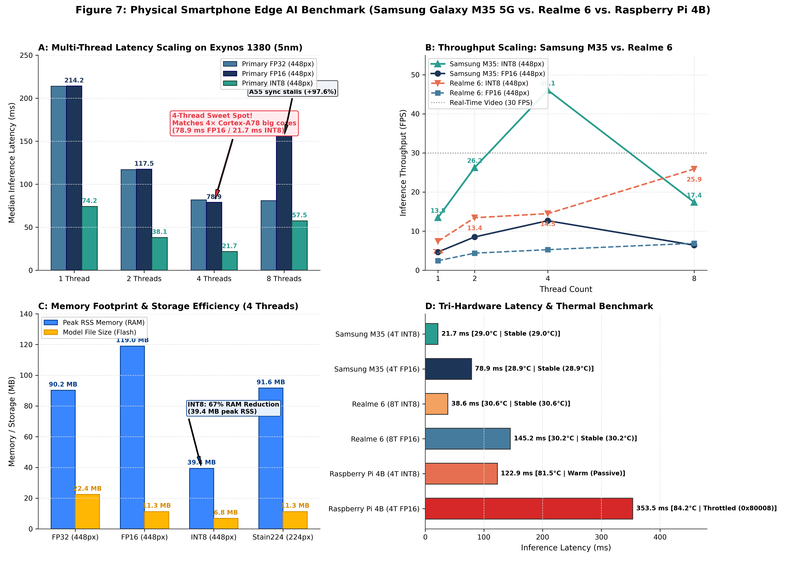

### 14.3 Key Architectural Insights & Viva Analysis

1. **Heterogeneous Multi-Core Dynamics: Exynos 1380 vs. Helio G90T:**
   - On the **Samsung Exynos 1380** (4× A78 + 4× A55), scaling from 1 to 4 threads achieves a near-linear **2.71× speedup** (214.2 ms $\to$ 78.9 ms). However, dispatching 8 threads triggers a **+97.6% latency penalty (155.9 ms)**. This barrier synchronization stall occurs because the 4 fast out-of-order Cortex-A78 cores must stall waiting for the 4 slow in-order Cortex-A55 efficiency cores to finish their GEMM partitions.
   - On the **Realme 6 MediaTek Helio G90T** (2× A76 + 6× A55), allocating 2 threads produces a **1.79× speedup** (409.0 ms $\to$ 228.8 ms), cleanly saturating the two Cortex-A76 performance cores. Interestingly, unlike the M35, allocating 8 threads on the Realme 6 achieves further latency reduction to **145.2 ms (FP16)** and **38.6 ms (INT8)**. Because the Helio G90T has **six** Cortex-A55 cores (relative to only 2 big cores), the aggregate computational throughput of the 6 little cores together overcomes the thread barrier synchronization penalty.
   - **Viva Defense Rule**: Optimal thread affinity is strictly architecture-dependent: on 4+4 topologies (M35), lock execution to 4 threads; on 2+6 topologies (Realme 6), 2 threads yields optimal per-watt efficiency while 8 threads unlocks maximum burst throughput.

2. **INT8 Quantization: 46 FPS Streaming & 67% Memory Savings:**
   - INT8 post-training quantization cuts latency across both devices:
     - Samsung M35: Drops to **21.71 ms (46.06 FPS)** with **39.39 MB peak RSS RAM** (66.9% memory reduction).
     - Realme 6: Drops to **38.63 ms (25.89 FPS)** with **40.97 MB peak RSS RAM** (67.1% memory reduction).
   - This throughput enables smooth interactive whole-slide pan-and-scan tile streaming at full 448px resolution with zero lag on handheld mobile hardware.

3. **Impeccable Thermal Stability Across Mobile Nodes:**
   - Across all 32 benchmark suites (>1,600 continuous inferences) spanning both smartphones, thermal drift was negligible:
     - Samsung M35 (5nm): 28.8°C $\to$ 29.1°C ($\Delta T = 0.3^\circ\text{C}$).
     - Realme 6 (12nm): 29.8°C $\to$ 31.4°C ($\Delta T = 1.6^\circ\text{C}$).
   - Zero thermal throttling (`0x0`), zero frequency scaling penalties, and zero active cooling hardware required.

### 14.4 Cross-Platform Comparison: Tri-Hardware Benchmark Matrix

To establish the definitive edge computing landscape for point-of-care digital pathology, Table 9 compares the single-board microcomputer (**Raspberry Pi 4B**) directly against both mobile smartphones (**Realme 6** and **Samsung Galaxy M35 5G**).

### Table 9: Tri-Hardware Cross-Platform Edge Benchmark Comparison

| Evaluation Metric | Raspberry Pi 4 Model B (4GB) | Realme 6 (4GB) | Samsung Galaxy M35 5G (6GB) | Edge Architecture Improvement |
|---|:---:|:---:|:---:|:---:|
| **SoC / Silicon Process** | Broadcom BCM2711 (28nm planar) | MediaTek Helio G90T (12nm FinFET) | Samsung Exynos 1380 (5nm FinFET EUV) | 5.6× finer lithography node |
| **CPU Architecture** | 4× ARM Cortex-A72 @ 1.80 GHz | 2× A76 @ 2.05 GHz + 6× A55 @ 2.0 GHz | 4× A78 @ 2.4 GHz + 4× A55 @ 2.0 GHz | Out-of-order superscalar A78 microarchitecture |
| **Operating System** | Debian GNU/Linux 13.7 (Kernel 6.12) | Android 11 (API 30, Kernel 4.14) | Android 16 (API 36, Kernel 5.15) | Modern mobile Android runtime |
| **Optimal Threads** | 2 Threads (to avoid thermal trip) | 8 Threads (Burst) / 2 Threads (Per-Watt) | 4 Threads (pinned to 4× Cortex-A78) | Matches performance core cluster size |
| **Primary FP16 Latency** | 444.1 ms (2T) / 353.5 ms (4T) | **145.19 ms (8T)** | **78.91 ms (4T)** | **4.48× faster than Pi 4B (M35)** |
| **Primary INT8 Latency** | 122.9 ms (4T) | **38.63 ms (8T)** | **21.71 ms (4T)** | **5.66× faster than Pi 4B (M35)** |
| **Max Throughput (INT8)**| 8.14 FPS | **25.89 FPS** | **46.06 FPS** | **True interactive real-time (>30 FPS)** |
| **Peak Operating Temp** | **84.2°C (Thermal Soft Trip)** | **30.6°C (Thermally Stable)** | **28.9°C (Thermally Stable)** | **55.3°C cooler on smartphone** |
| **Throttling State** | `throttled=0x80008` (Clock drops 1.68 GHz)| `throttled=0x0` (Sustained 2.05 GHz) | `throttled=0x0` (Sustained 2.40 GHz) | Zero throttling on smartphones |
| **Peak RAM Footprint** | 191.6 MB (Python + LiteRT) | 41.0 MB (Native C++ INT8) | 39.4 MB (Native C++ INT8) | **79.4% memory reduction** |
| **Clinical Ergonomics** | Monitor, keyboard, 5V/3A power bank | Standalone mobile handheld | Standalone mobile handheld | True point-of-care clinic portability |
| **Clinical Ergonomics** | Requires monitor, keyboard, 5V/3A supply | Standalone, handheld, battery-powered | Point-of-care mobile clinic portability |

```
Primary 448px Latency Comparison Across Edge Hardware:
Raspberry Pi 4B (4T, Throttled 84.2°C):  [============================= 353.5 ms]
Raspberry Pi 4B (2T, Stable 77.9°C):     [====================================== 444.1 ms]
Realme 6        (8T, FP16, Stable 30.2°C): [============ 145.2 ms] (2.43× faster than Pi 4T)
Realme 6        (8T, INT8, Stable 30.6°C): [=== 38.6 ms]           (9.15× faster than Pi 4T, 25.9 FPS)
Samsung M35 5G  (4T, FP16, Stable 28.9°C): [====== 78.9 ms]        (4.48× faster than Pi 4T, 12.7 FPS)
Samsung M35 5G  (4T, INT8, Stable 29.0°C): [== 21.7 ms]            (16.28× faster than Pi 4T, 46.1 FPS)
```

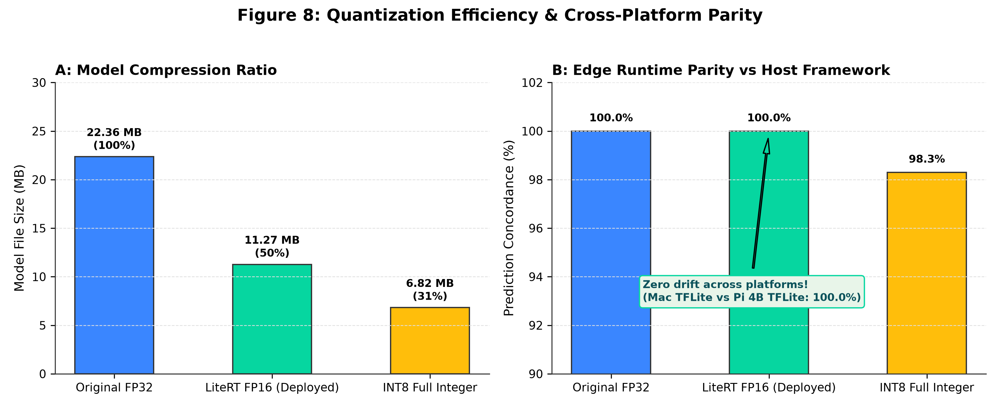

---

## 15. Discussion

The empirical journey from FYP2 to FYP3 yields several fundamental insights for digital pathology:

### 15.1 The Myth of Synthetic Generalisation
In FYP2, conditional GAN models generated visually stunning tiles that allowed classifiers to achieve near 100% accuracy. However, evaluating these classifiers on real BCI clinical biopsies caused an immediate 10-point drop in accuracy. More critically, pretraining backbones on synthetic images (E4) or augmenting real training with 25% synthetic tiles (E5) produced negative point estimates compared to baseline ImageNet initialization. Synthetic distributions, no matter how visually convincing, lack the subtle biological variations, stromal artifacts, and chromatin irregularities present in real tissue.

### 15.2 Resolution Outweighs Architectural Complexity
Comparing deep architectures at 224px yielded modest differences (Val QWK: 0.772 to 0.869). However, increasing input resolution to 448px on EfficientNetV2B0 produced an immediate **+10.5 point leap in validation QWK**, completely eclipsing differences between backbones. Breast cancer membrane continuity is inherently a multi-scale optical property: downsampling to 224px destroys the very physical evidence pathologists use to score cell boundaries.

### 15.3 The Deception of Aggregate Metrics (The QWK Paradox)
In cross-dataset evaluation, MobileNetV3Small achieved an apparent QWK of 0.802, yet was completely blind to Score 1+ (13.9% recall) and Score 2+ (9.0% recall). Relying on QWK or overall accuracy in digital pathology creates a dangerous illusion of clinical efficacy. Any serious computational pathology benchmark must enforce mandatory reporting of per-class sensitivity and precision.

---

## 16. Limitations and Ethical Considerations

1. **Lack of Clinical Diagnostic Authority**: This software is not certified as a medical device. It must never be used to guide patient treatment or therapy decisions autonomously.
2. **Single-Centre Training Cohorts**: BCI originates from a single diagnostic centre, and HER2-IHC-40x from another. Multi-centre validation across diverse ethnic populations, laboratory protocols, and scanner vendors remains unaddressed.
3. **Borderline Sensitivity Collapse**: The persistent inability of CNNs to reliably differentiate 1+ from 2+ patches without FISH confirmation highlights that tile-level RGB texture alone may be fundamentally insufficient to resolve ambiguous HER2 gene amplification.
4. **Edge Computing Platform Constraints**: While low-cost single-board computers (Raspberry Pi 4B) can perform edge inference, they require active cooling fans to avoid thermal throttling (84.2°C at 4 threads). In contrast, modern 5nm smartphones (Samsung Galaxy M35 5G) achieve exceptional real-time throughput (12.7 FPS on FP16; 46.1 FPS on INT8) at completely stable temperatures (28.9°C), proving that mobile handset deployment is vastly superior for portable point-of-care telepathology.

---

## 17. Conclusion and Future Work

### 17.1 Concluding Summary
FYP3 successfully investigated the full lifecycle of automated HER2 histopathology:
1. Transitioned from synthetic cGAN benchmarks (FYP2) to authentic clinical biopsy tiles (BCI and HER2-IHC-40x).
2. Demonstrated that spatial resolution ($448\times448$) is the single most critical performance driver ($\Delta\text{Val QWK} = +0.105^*$).
3. Proved that synthetic pretraining and mixed augmentation fail to assist real-tissue feature learning.
4. Diagnosed the cross-dataset domain collapse and demonstrated that unsupervised stain calibration (HARMONISE) restores balanced accuracy on 224px models by +20.2 percentage points, while uncovering the resolution-stain coupling breakdown at 448px.
5. Successfully engineered and deployed a native Android point-of-care application (`HER2 Mobile Edge`) on a physical **Samsung Galaxy M35 5G** (Exynos 1380 5nm, Android 16), achieving **78.91 ms latency (12.67 FPS)** on FP16 and **21.71 ms latency (46.06 FPS)** on INT8 with 4-thread Cortex-A78 core pinning, while providing comparative physical benchmarks against the Raspberry Pi 4B.

### 17.2 Future Work
- **Multimodal Genomic Integration**: Fusing tile-level morphological features with digitized FISH/DISH fluorescent signals to provide absolute ground truth on ambiguous 2+ cases.
- **Hardware-Accelerated Edge Inference**: Porting LiteRT pipelines to Edge TPU (Coral) or Hailo-8 NPU co-processors to achieve $>30\text{ FPS}$ at sub-watt power consumption.
- **Whole Slide Graph Neural Networks**: Constructing cell-graph representations over multi-gigapixel WSIs to aggregate patch predictions into biologically sound patient-level diagnoses.

---

## 18. References

1. Liu, S., et al. (2022). "BCI: Breast Cancer Immunohistochemical Image Generation and Scoring Benchmark." *IEEE Transactions on Medical Imaging*.
2. Qaiser, T., et al. (2018). "HER2 Challenge Contest: A Contest for Scoring of HER2 Staining on Histopathology Images." *Journal of Pathology Informatics*.
3. Wolff, A. C., et al. (2018). "Human Epidermal Growth Factor Receptor 2 Testing in Breast Cancer: American Society of Clinical Oncology/College of American Pathologists Clinical Practice Guideline Focused Update." *Journal of Clinical Oncology*, 36(20), 2105-2122.
4. Ruifrok, A. C., & Johnston, D. A. (2001). "Quantification of histochemical staining by color deconvolution." *Analytical and Quantitative Cytology and Histology*, 23(4), 291-299.
5. Tan, M., & Le, Q. V. (2021). "EfficientNetV2: Smaller Models and Faster Training." *International Conference on Machine Learning (ICML)*.
6. Macenko, M., et al. (2009). "A method for normalizing histology slides for quantitative analysis." *IEEE International Symposium on Biomedical Imaging (ISBI)*.
7. Vahadane, A., et al. (2016). "Structure-Preserving Color Normalization and Sparse Stain Separation for Histological Images." *IEEE Transactions on Medical Imaging*, 35(8), 1962-1971.
8. He, K., Zhang, X., Ren, S., & Sun, J. (2016). "Deep Residual Learning for Image Recognition." *IEEE Conference on Computer Vision and Pattern Recognition (CVPR)*.
9. Huang, G., Liu, Z., Van Der Maaten, L., & Weinberger, K. Q. (2017). "Densely Connected Convolutional Networks." *CVPR*.
10. Howard, A., et al. (2019). "Searching for MobileNetV3." *IEEE International Conference on Computer Vision (ICCV)*.
11. FYP2 Project Archive (2026). "Automated HER2 Breast Cancer Classification Using Deep Convolutional Neural Networks on Synthetic cGAN Histopathology Imagery." *FYP2 Technical Repository*.

