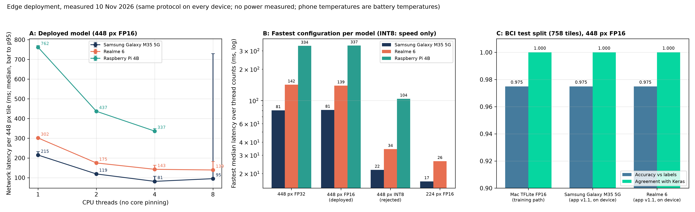
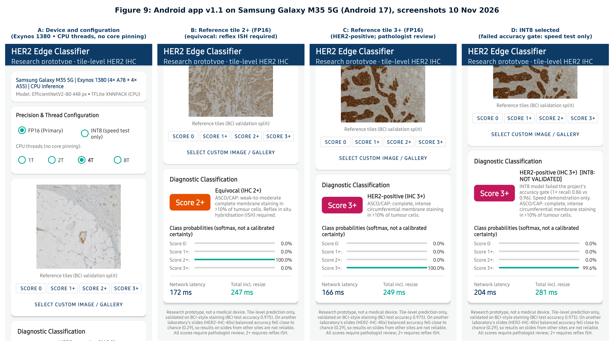
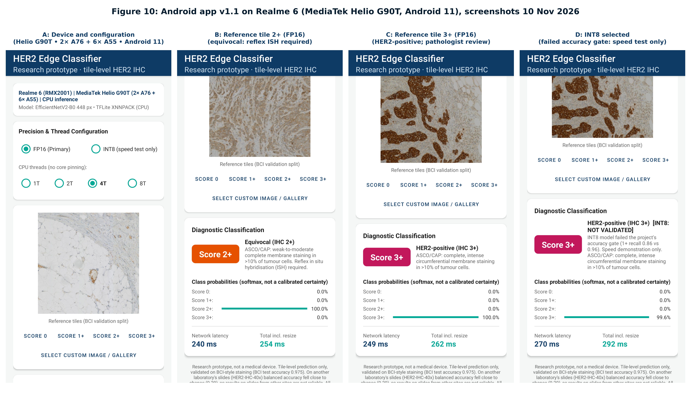

# Cross-Dataset Generalisation, Stain Calibration, and Mobile Edge Deployment for HER2 Histopathology Classification

[](https://www.python.org/)
[](https://www.tensorflow.org/)
[](https://developer.android.com/)
[](https://www.tensorflow.org/lite)
[]()

This repository contains the implementation, experiment code, exported edge models and Android deployment assets for our research on **Automated HER2 Breast Cancer Scoring from Immunohistochemistry (IHC) Tissue**. All numbers below are taken from `FYP3_FINAL_REPORT.md` (revised 10 November 2026), whose corrections to the 31 October version are itemised in the FYP3 project's `experiments_v2/REPORT_CORRECTIONS_v2.md`.

---

## Executive Research Overview

Automated scoring of Human Epidermal Growth Factor Receptor 2 (HER2) from immunohistochemistry (IHC) tissue sections supports breast cancer stratification and decides eligibility for anti-HER2 therapy. Models trained on synthetic conditional-GAN imagery (FYP2) reach near-perfect accuracy on that synthetic distribution; transferring them to real tissue from different laboratories exposes serious weaknesses.

This project studies the transition from synthetic benchmarks to real tissue using **4,873 IHC tiles from the Breast Cancer Immunohistochemical (BCI) dataset** (Liu et al., CVPR Workshops 2022) and **9,940 tiles from the external HER2-IHC-40x dataset** (University of Malaya; *Data in Brief* 2025, doi 10.1016/j.dib.2025.111922).

```
+-------------------------------------------------------------------------------------------------------------------------+
|                                           FYP3 SYSTEM ARCHITECTURE & WORKFLOW                                           |
|                                                                                                                         |
|   1. In-Domain Benchmark (BCI)         2. External Calibration                3. Edge Deployment (10 Nov 2026)          |
|   +------------------------------+     +--------------------------------+     +-----------------------------------+     |
|   | 4,873 BCI IHC tiles          | --> | HARMONISE: 2 optical-density   | --> | Android app v1.1: 758/758 agree   |     |
|   | 691 slide fragments, grouped |     | gains (dev tiles vs BCI train) |     | Samsung M35: 81.4 ms (4 threads)  |     |
|   | 448 px EfficientNetV2B0      |     | 224 px BalAcc 0.301 -> 0.503   |     | Realme 6: 139.1 ms (8 threads)    |     |
|   | Test acc 0.975, QWK 0.959    |     | 448 px breaks; few-shot 0.782  |     | Pi 4B: 336.5 ms (4 threads)       |     |
|   +------------------------------+     +--------------------------------+     +-----------------------------------+     |
+-------------------------------------------------------------------------------------------------------------------------+
```

### Key Scientific Findings:
1. **Resolution helps EfficientNetV2B0 (not confirmed for MobileNetV3Small)**: Raising input resolution from $224\times224$ to $448\times448$, against a batch-matched 224 px control, gives **$\Delta\text{Val QWK} = +0.105$** ($95\%\text{ CI } [0.056, 0.168]$) and $\Delta\text{Test QWK} = +0.063$ ($[0.026, 0.116]$) on EfficientNetV2B0. This gives the primary in-domain model `EfficientNetV2B0__ce__hires` (**test acc 0.975, test QWK 0.959**). For MobileNetV3Small the effect was not confirmed (val ΔQWK +0.090, CI $[-0.007, 0.207]$; test about 0). One training seed per arm.
2. **Synthetic training did not transfer to BCI**: Initialising from weights trained on synthetic cGAN images ($\Delta\text{Val QWK} = -0.015$) or mixing 25% synthetic tiles into training ($\Delta\text{Val QWK} = -0.023$) gave no measurable change over ImageNet initialisation (both CIs span 0). On the external set, however, the FYP2 synthetic-trained networks score better than every BCI network (balanced accuracy 0.61–0.73), which is explained by that set's per-class colour selection, not by better tissue understanding.
3. **Cross-dataset collapse and HARMONISE calibration**: Zero-shot on the HER2-IHC-40x test split, BCI-trained networks collapse (accuracy 0.419–0.586, balanced accuracy 0.260–0.381; 43%–94% of tiles predicted 3+). HARMONISE, an unsupervised optical-density gain calibration fitted on unlabelled target development tiles against BCI training tiles, raises 224 px EfficientNetV2B0 balanced accuracy from 0.301 to **0.503** without retraining. It converts false 3+ calls into false 2+ calls (61% of negatives called 2+) and breaks the 448 px model (balanced accuracy 0.186); a development-tile dose-response attributes this to the **haematoxylin** gain. The external test split was examined during earlier diagnostics, so all external results are exploratory.
4. **The Clinical QWK Paradox**: High aggregate Quadratic Weighted Kappa ($>0.80$) can mask failure on the borderline classes: MobileNetV3Small with HARMONISE has QWK 0.802 but 1+ recall 0.139 and 2+ recall 0.090. Per-class recall and error-type counts should be reported.
5. **Edge deployment with measured on-device accuracy**: Android app v1.1, whose preprocessing is bit-exact with training, reproduces the validated predictions on **758/758 BCI test tiles** on both a **Samsung Galaxy M35 5G** and a **Realme 6** (accuracy 0.975). Median network latency per 448 px tile (FP16): **81.4 ms** (Samsung, 4 threads), **139.1 ms** (Realme, 8 threads) and **336.5 ms** (Raspberry Pi 4B, 4 threads). INT8 is 3–4× faster but fails the accuracy gate (agreement 0.928) and is reported for speed only. No power was measured.
6. **Extended evaluation** (FYP3 `experiments_v2/`): the 448 px model has the lowest clinical workflow cost on BCI test (0.12 [0.06, 0.22] vs 0.31 [0.20, 0.48] for 224 px) and supports referral (93.7% coverage: accuracy 0.975 → 0.989), but is defocus-sensitive (blur σ = 0.9 µm costs 0.17 balanced accuracy vs 0.03 at 224 px). Grad-CAM suggests correct external 1+ calls attend to glass and pale areas, a likely shortcut. AdaBN improves every network over raw input (+0.06 to +0.23) and rescues the 448 px model (0.186 → 0.516), but the best unsupervised external balanced accuracy is about 0.52–0.53. Fine-tuning on **5 labelled tiles per class reaches 0.782 ± 0.053** test balanced accuracy. A frozen ImageNet backbone costs 0.193 validation accuracy.

---

## Summary of Results

### 1. In-Domain Performance (BCI, grouped split)

Values from the report's Tables 1–2 (`results/runs/*/summary.json`). The test split is report-only; test scores are higher than validation for every network.

| Model Architecture | Input Res | Loss | Val Acc | Val BalAcc | Val QWK | Test Acc | Test BalAcc | Test QWK |
|---|:---:|:---:|:---:|:---:|:---:|:---:|:---:|:---:|
| **`EfficientNetV2B0__ce__hires` (Primary)** | **$448\times 448$** | **CE** | **0.950** | **0.945** | **0.935** | **0.975** | **0.973** | **0.959** |
| `MobileNetV3Small__ce__hires` | $448\times 448$ | CE | 0.898 | 0.897 | 0.865 | 0.908 | 0.898 | 0.874 |
| `EfficientNetV2B0__ce` (Baseline) | $224\times 224$ | CE | 0.895 | 0.875 | 0.869 | 0.926 | 0.917 | 0.915 |
| `ResNet50__ce` | $224\times 224$ | CE | 0.902 | 0.881 | 0.829 | 0.949 | 0.934 | 0.932 |
| `DenseNet121__ce` | $224\times 224$ | CE | 0.908 | 0.894 | 0.854 | 0.942 | 0.922 | 0.910 |
| `MobileNetV3Small__ce` | $224\times 224$ | CE | 0.854 | 0.822 | 0.763 | 0.913 | 0.886 | 0.888 |

### 2. Edge Benchmark Comparison (measured 10 November 2026)

One protocol on all devices: 10 warm-up runs, then 100 timed invokes; 60 s cool-down between phone configurations; a fresh process for each Raspberry Pi configuration; no CPU affinity set anywhere (the OS scheduler chooses the cores). Latency is network time per tile; decode and resize are not included. Values are medians, p95 in brackets.

| Evaluation Dimension | Raspberry Pi 4 Model B (4 GB) | Realme 6 (RMX2001) | Samsung Galaxy M35 5G (SM-M356B) |
|---|:---:|:---:|:---:|
| **Processor SoC** | Broadcom BCM2711 | MediaTek Helio G90T | Samsung Exynos 1380 |
| **CPU Cluster** | 4× Cortex-A72 @ 1.8 GHz | 2× A76 @ 2.05 GHz + 6× A55 @ 2.0 GHz | 4× A78 @ 2.4 GHz + 4× A55 @ 2.0 GHz |
| **OS / Runtime** | Debian 13 aarch64 / `ai_edge_litert` 2.5.4 (Python) | Android 11 (API 30) / TFLite `benchmark_model` (XNNPACK) | Android 17 (API 37) / TFLite `benchmark_model` (XNNPACK) |
| **Fastest thread count (448 px FP16)** | 4 | 8 | 4 |
| **Primary 448 px FP16 latency, fastest** | 336.5 ms [349.2] | **139.1 ms [181.8]** | **81.4 ms [107.5]** |
| **Speed vs Pi 4B (fastest configurations)** | — | 2.4× faster | 4.1× faster |
| **Primary 448 px FP16 latency, 1 thread** | 761.8 ms | 301.7 ms | 214.9 ms |
| **224 px FP16 latency, fastest** | not measured | 26.3 ms (8 threads) | 16.8 ms (4 threads) |
| **448 px INT8 latency (rejected; speed only)** | 104.1 ms (4 threads) | 34.3 ms (8 threads) | 21.7 ms (4 threads) |
| **Peak memory, 448 px FP16** | 250 MB (Python process) | 124 MB | 120 MB |
| **Temperature** | SoC ≤ 62.8 °C; `throttled=0x0` before and after every configuration | Battery 29.6 → 32.0 °C (CPU throttling not observable on Android) | Battery 29.7 → 31.7 °C (CPU throttling not observable on Android) |
| **On-device accuracy, BCI test (758 tiles), app v1.1** | — | 0.975; 758/758 agree with Keras | 0.975; 758/758 agree with Keras |
| **Power / energy** | not measured | not measured | not measured |

- On CPU, FP16 runs at FP32 speed (the weights are expanded to FP32); FP16 only halves the file size (11.3 vs 22.4 MiB) and is lossless (test accuracy 0.975, agreement 1.000).
- Thread scaling is sub-linear on every device. On the Samsung, 8 threads is slower and much more variable than 4 (FP16: 95.1 ms, p95 729.4 ms). No core pinning was used, so no core-type explanation is claimed.
- INT8 fails the project's 0.95 agreement gate (0.928) and loses 10 points of 1+ recall (0.855). On the Pi it agrees with Keras on 109 of 120 reference tiles, so INT8 results are platform-dependent.
- The 31 October edge figures (Pi INT8 122.9 ms, phone "throttled=0x0", INT8 "46 FPS", "per-watt" efficiency, core-pinning explanations) are superseded; see §14.5 of the report.



---

## Native Android Application: HER2 Edge Classifier (v1.1)

A research-prototype Android Studio application (`HER2 Edge Classifier`, package `com.fyp3.her2classifier`, version 1.1) is provided in [`android_app/`](android_app/):
- **APK Installation**: Pre-built APK available at [`deployment/apk/HER2_Mobile_Edge.apk`](deployment/apk/HER2_Mobile_Edge.apk).
- **Validated Preprocessing**: Version 1.0 resized tiles in one step (1024 → 448 px), which did not match training (1024 → Lanczos 512 → bilinear 448); simulated on the Mac, this changed 0.1–2.8% of predictions. Version 1.1 uses a Kotlin port of Pillow's fixed-point resampler (`PilResample.kt`), whose Python twin is bit-identical to PIL.
- **On-Device Inference**: TensorFlow Lite 2.16.1 on the CPU with XNNPACK; 1, 2, 4 or 8 threads, with no core pinning. The app shows the detected device, single-tile network latency and total time including resize.
- **Model Choice**: FP16 448 px (validated, primary). INT8 is labelled "speed test only" and every INT8 result carries a warning that it failed the accuracy gate.
- **Clinical Decision Support Text**: Class probability bars and ASCO/CAP guideline text (including HER2-low for 1+ and reflex in situ hybridisation for 2+), plus a disclaimer stating that results on other laboratories' slides are not reliable.
- **Inputs**: 4 bundled reference tiles from the BCI validation split, and a gallery picker.
- **Validation Mode**: A research mode classifies pushed tiles through exactly the UI path; it was used to measure on-device accuracy (758/758 agreement on both phones).
- **Fixes**: Radio-button labels that were invisible in dark mode on the Realme are fixed.
- **Packaging Note**: Android 15+ warns that the bundled TFLite 2.16.1 native library is not 16 KB page-aligned. Both test phones use 4 KB pages; devices with 16 KB pages would need a newer runtime (LiteRT), re-validated.





---

## Repository Directory Structure

```
HER2-Edge-Classification/
├── README.md                              # Main project documentation and quickstart
├── requirements.txt                       # Core Python package dependencies
├── DATASET.md                             # Dataset acquisition & directory layout guide
├── FYP3_REPRODUCTION_GUIDE.md             # Detailed step-by-step reproduction instructions
├── FYP3_FINAL_REPORT.md                   # Final technical report (revised 10 Nov 2026)
├── FYP3_PRESENTATION_OUTLINE.md           # 16-slide defense presentation outline
├── FINAL_MODEL_SELECTION.md               # Model selection criteria and rationale
├── DEPLOYMENT_README.md                   # Edge & mobile deployment technical manual
│
├── src/                                   # Source code
│   ├── common.py                          # Metric computation, seeding, data loaders
│   ├── config.py                          # Hyperparameter configuration & path definitions
│   ├── prepare_data.py                    # Tile preprocessing & official BCI split
│   ├── analysis_slides.py                 # Slide-fragment reconstruction by tile-edge matching
│   ├── make_grouped_split.py              # Fragment-grouped train/val/test split (no slide or patient IDs exist)
│   ├── train.py                           # Baseline deep learning training harness
│   ├── train_variant.py                   # Model variant training (resolution, batch, etc.)
│   ├── variants.py                        # Experimental variant configurations
│   ├── evaluate_all.py                    # In-domain evaluation (val and test)
│   ├── external_eval.py                   # Zero-shot evaluation on HER2-IHC-40x
│   ├── select_models.py                   # Model selection (results/selection.json)
│   ├── deploy.py                          # TensorFlow Lite conversion & INT8 quantization
│   ├── paired.py                          # Paired bootstrap effects & 95% confidence intervals
│   └── report.py                          # Writes results/REPORT.md (predates E1–E5)
│
├── splits/                                # Fragment-grouped split manifests
│   ├── split_manifest_grouped.csv         # Grouped train/val/test split (4,873 tiles)
│   └── split_manifest_official.csv        # Official BCI split (leaks across fragments; reference only)
│
├── deployment/                            # Mobile & edge deployment artifacts
│   ├── apk/                               # Pre-built Android debug APK
│   │   └── HER2_Mobile_Edge.apk           # Installation package (app v1.1)
│   ├── models/                            # Exported TensorFlow Lite models
│   │   ├── primary_bci_hires_fp16.tflite  # Primary 448px FP16 model (11.3 MiB; deployed)
│   │   ├── primary_bci_hires_int8.tflite  # Primary 448px INT8 model (6.8 MiB; failed accuracy gate, speed tests only)
│   │   ├── primary_bci_hires_fp32.tflite  # Primary 448px FP32 baseline (22.4 MiB)
│   │   └── experimental_stain224_fp16.tflite # Experimental 224px FP16 model for HARMONISE-calibrated input (needs float32 input)
│   ├── sample_tiles/                      # Bundled reference tiles (BCI validation split)
│   │   ├── sample_tile_class_0.png        # Score 0 (negative)
│   │   ├── sample_tile_class_1.png        # Score 1+ (negative, HER2-low)
│   │   ├── sample_tile_class_2.png        # Score 2+ (equivocal)
│   │   └── sample_tile_class_3.png        # Score 3+ (positive)
│   ├── benchmark_results/                 # 31 Oct 2026 benchmark CSVs (superseded by the 10 Nov measurements; report §14.5)
│   │   ├── benchmark_samsung_m35.csv      # Samsung Galaxy M35 5G, 31 Oct run
│   │   ├── benchmark_realme_6.csv         # Realme 6, 31 Oct run
│   │   ├── benchmark_primary_pi4.csv      # Raspberry Pi 4B primary model, 31 Oct run
│   │   └── benchmark_experimental_pi4.csv # Raspberry Pi 4B experimental model, 31 Oct run
│   ├── benchmark.py                       # Cross-platform edge benchmarking script
│   └── predict.py                         # Single tile command-line inference utility
│
├── android_app/                           # Android Studio project (Kotlin)
│   ├── app/src/main/                      # App source code, UI layouts, assets
│   ├── build.gradle                       # Gradle build configuration
│   └── gradlew                            # Gradle wrapper script
│
├── final_report_figures/                  # 300 dpi report figures
│   ├── fig1_bci_model_comparison.png      # In-domain BCI model comparison
│   ├── fig2_paired_effects_forest.png     # Paired effects forest plot with bootstrap CIs
│   ├── fig3_stain_optical_density_distributions.png # Optical density distributions
│   ├── fig4_cross_dataset_collapse_and_harmonise.png # Domain collapse & HARMONISE
│   ├── fig5_classwise_performance_and_qwk_paradox.png # Classwise recall & QWK paradox
│   ├── fig6_harmonise2_bootstrap_and_flagging.png # Reliability & selective review analysis
│   ├── fig7_smartphone_edge_benchmark.png # Edge latency benchmark, measured 10 Nov 2026
│   ├── fig8_quantization_and_agreement.png # Quantization & agreement
│   ├── fig9_mobile_app_interface_and_inference.png # App v1.1 on Samsung M35
│   └── fig10_realme6_app_interface_and_inference.png # App v1.1 on Realme 6
│
├── generate_final_report_figures.py       # Figure generator for Figs 1-6 & 8
├── generate_smartphone_figures.py         # Superseded 31 Oct Fig 7 generator (contains an unmeasured Pi INT8 value; do not use)
├── create_app_composite_figure.py         # Figure generator for Fig 9
├── create_realme_6_composite_figure.py    # Figure generator for Fig 10
│
├── final_reports/tables/                  # CSV summary metric tables
└── results/                               # Evaluation logs, CSVs, and predictions
    ├── metrics_all.csv                    # In-domain metrics (predates E1–E5; stale)
    ├── selection.json                     # Model selection metadata (predates E1–E5; stale)
    └── external/                          # Zero-shot cross-dataset outputs (her2_40x/)
```

---

## Quickstart & Reproduction Guide

### 1. Environment Setup

```bash
# Clone the repository
git clone https://github.com/Dhaneswarareddy/HER2-Edge-Classification.git
cd HER2-Edge-Classification

# Create virtual environment (Python 3.11 recommended)
python3.11 -m venv venv
source venv/bin/activate

# Install dependencies
pip install --upgrade pip
pip install -r requirements.txt
```

### 2. Dataset Preparation

Follow [`DATASET.md`](DATASET.md) to download:
1. **BCI Dataset** (Breast Cancer Immunohistochemical; Liu et al., CVPR Workshops 2022, arXiv:2204.11425; non-commercial licence): Extract to `data/bci/`.
2. **HER2-IHC-40x Dataset** (University of Malaya; *Data in Brief* 2025, doi 10.1016/j.dib.2025.111922; Zenodo 10.5281/zenodo.15179607; CC BY-SA 4.0): Extract to `data/external_her2_40x/`. Use the WSI-based test split; the release gives no slide IDs.

Run data preprocessing:
```bash
python src/prepare_data.py
python src/analysis_slides.py
python src/make_grouped_split.py
```

### 3. Model Training & Evaluation

```bash
# Train the primary high-resolution EfficientNetV2B0 model (448px)
python src/train_variant.py --model EfficientNetV2B0 --loss ce --variant hires

# Evaluate all trained backbones on the in-domain validation and test splits
python src/evaluate_all.py

# Run cross-dataset zero-shot evaluation on HER2-IHC-40x (add --cpu on macOS for 448 px networks)
python src/external_eval.py --data-dir <dir containing class_0 ... class_3+> --runs EfficientNetV2B0__ce EfficientNetV2B0__ce__hires
```

HARMONISE stain calibration and the extended evaluation are run from the FYP3 project (`next_experiment/run_harmonise.py`, `experiments_v2/`). HARMONISE needs the BCI training tiles as its reference, and the calibrated image must be passed to the network as float32 (an 8-bit round trip changes 1.4% of predictions).

### 4. Recreating Publication Figures

Figures 1–6 and 8–10 in [`final_report_figures/`](final_report_figures/) can be regenerated from stored results:
```bash
# Generate core research figures 1-6 and Figure 8:
python generate_final_report_figures.py

# Generate Android App composite figures (Figures 9 and 10):
python create_app_composite_figure.py
python create_realme_6_composite_figure.py
```

Figure 7 (10 Nov 2026 edge benchmark) is generated in the FYP3 project by `experiments_v2/08_edge/make_edge_figures.py`. Do not use `generate_smartphone_figures.py`: it reproduces the superseded 31 October figure, including a Pi INT8 latency that was never measured.

### 5. Running the Android Application

- **Direct Installation**:
  ```bash
  adb install deployment/apk/HER2_Mobile_Edge.apk
  ```
- **Building from Source**: Open `android_app/` in Android Studio and click **Run** (or execute `./gradlew assembleDebug`).

---

## Scientific Disclosures & Ethical Considerations

1. **Investigational Prototype**: This software is an academic research prototype. It was not evaluated prospectively, in a reader study, or by a regulator. It is not a medical device and must never be used for clinical diagnosis, patient management, or therapeutic selection.
2. **Equivocal Vulnerability**: Automated scoring is weak on borderline Score 1+ and Score 2+ tiles. On the external test split, the 224 px EfficientNetV2B0 with HARMONISE has 1+ recall 0.177 and 2+ precision 0.093; MobileNetV3Small has 2+ recall 0.090; DenseNet121 has 1+ and 2+ recall 0.000. Score 2+ requires reflex in situ hybridisation (ISH) per the ASCO/CAP guideline.
3. **Stain Calibration Nature**: HARMONISE is an empirical calibration (two gains fitted to match optical-density quantiles of target development tiles to BCI training tiles), not a physical stain normalisation. It needs that reference domain.
4. **Data Limits**: Neither dataset releases slide or patient identifiers; BCI fragments were reconstructed by tile-edge matching, and BCI labels are inherited from the parent WSI. Patient- or slide-level generalisation cannot be claimed.
5. **External Test Split Not Untouched**: The 1,847-tile HER2-IHC-40x test split was examined during diagnostic audits; all external results are exploratory, and their confidence intervals are optimistic.
6. **Edge Measurements**: No power or energy was measured on any device. Phone temperatures are battery temperatures; Android does not expose CPU throttling. On-device accuracy was measured on BCI tiles only. The INT8 model failed the accuracy gate and is reported for speed only.

---

## Citation

If you find this work or codebase helpful in your research, please cite:

```bibtex
@article{reddy2026her2edge,
  title={Cross-Dataset Generalisation, Stain Calibration, and Mobile Edge Deployment for HER2 Histopathology Classification},
  author={Karri Mohan Naga Durga Dhaneswara Reddy},
  year={2026},
  institution={Department of Electronics and Communication Engineering},
  url={https://github.com/Dhaneswarareddy/HER2-Edge-Classification}
}
```
